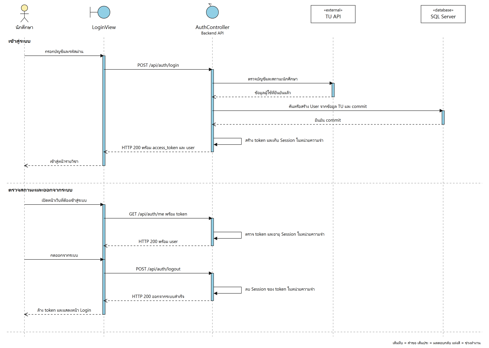
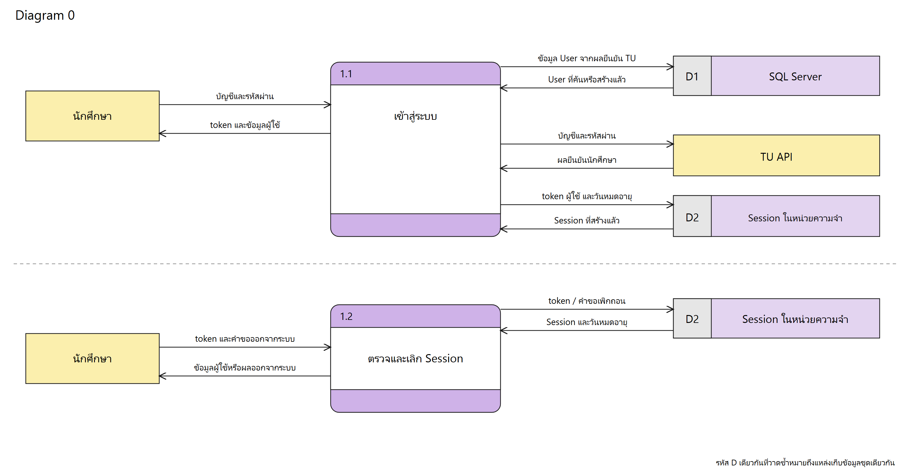

# U1 เข้าสู่ระบบด้วยบัญชี TU

แผนภาพสำหรับอธิบายการทำงานของระบบ ใช้สีและสัญลักษณ์ตามชุด U6

## ระบบนี้ช่วยอะไร

เข้าสู่ระบบด้วยบัญชี TU ผ่านหน้าเว็บที่เชื่อมกับ Backend และข้อมูลของระบบ

## UML Sequence Diagram

อ่านจากบนลงล่าง เส้นทึบคือคำขอ เส้นประคือผลตอบกลับ แท่งสีแสดงช่วงทำงาน ชื่อ View รวมหน้าเว็บและ JavaScript ส่วน Controller รวม Router, Service และ DAO; คำขอผ่าน Node proxy แต่ไม่แยกเป็น lifeline ภาพเน้นเส้นทางสำเร็จ รายละเอียด error อยู่ในเอกสารออกแบบเดิม

TU API ในภาพเป็นขอบเขตยืนยันบัญชี local อาจตั้งเป็น TU mock ภาพนี้ไม่ใช่ผลยืนยัน TU จริง AuthService บันทึก User ลง SQL แต่เก็บ token และ Session ในหน่วยความจำของ backend แต่ละ process ไม่ใช่ตาราง SQL และไม่ได้ hash token ลงฐานข้อมูล Restart backend แล้วต้อง Login ใหม่; ไม่เก็บรหัสผ่านลง SQL การยืนยันไม่ผ่านไม่ให้ token

## Dataflow Diagram

กล่องสีเหลืองคือนักศึกษาหรือระบบภายนอก กล่อง process สีม่วงแสดงงาน ลูกศรระบุข้อมูลที่ส่งระหว่างกัน รหัส D เดียวกันที่วาดซ้ำหมายถึงแหล่งข้อมูลชุดเดียวกัน การตรวจ token อยู่ที่ขอบเขต Backend ตาม U1 ไม่ได้วาดซ้ำทุก process

**1.1 เข้าสู่ระบบ** รับ บัญชีและรหัสผ่าน แล้วส่งกลับ token และข้อมูลผู้ใช้ โดยอ่านหรือเปลี่ยนข้อมูลตามลูกศรในภาพ

**1.2 ตรวจและเลิก Session** รับ token และคำขอออกจากระบบ แล้วส่งกลับ ข้อมูลผู้ใช้หรือผลออกจากระบบ โดยอ่านหรือเปลี่ยนข้อมูลตามลูกศรในภาพ

## ไฟล์อ้างอิง

- [auth.py](../../../backend/app/routers/auth.py)
- [auth.py](../../../backend/app/services/auth.py)
- [task7-login-sequence-diagram.md](task7-login-sequence-diagram.md)
- [SVG Sequence ที่แก้ไขได้](diagrams/u1-sequence.svg)
- [SVG Dataflow ที่แก้ไขได้](diagrams/u1-dataflow.svg)
