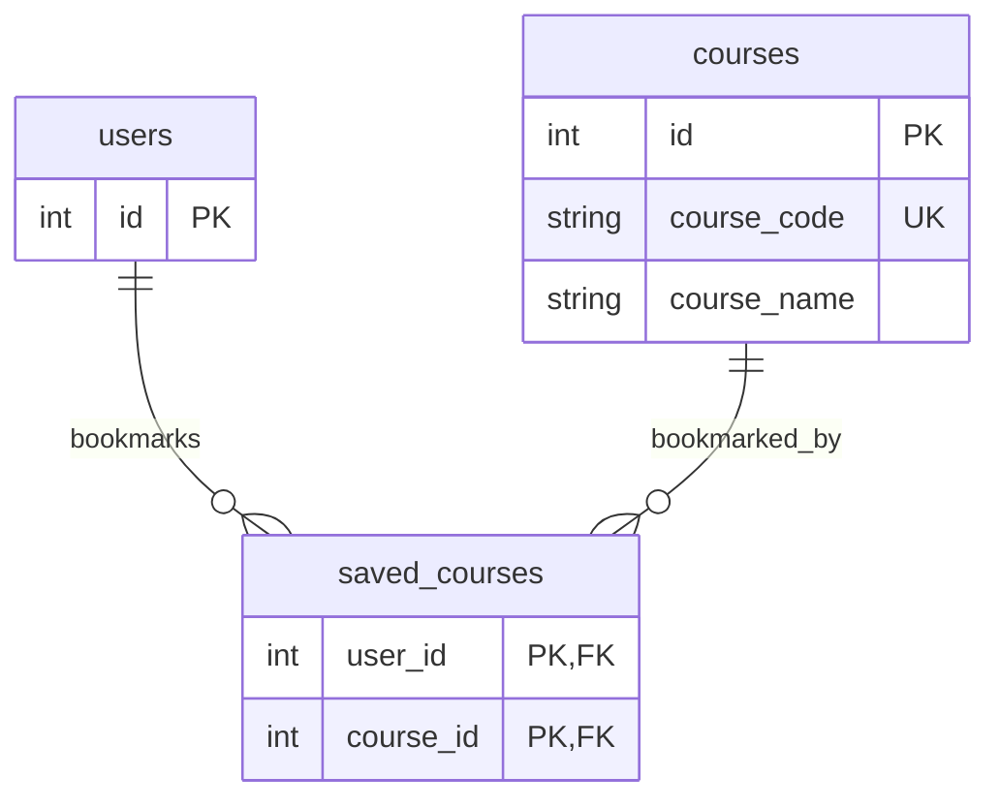
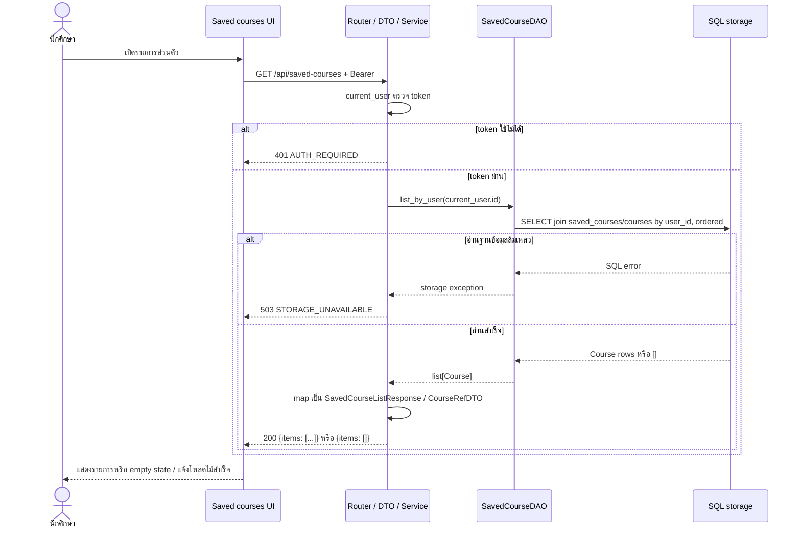
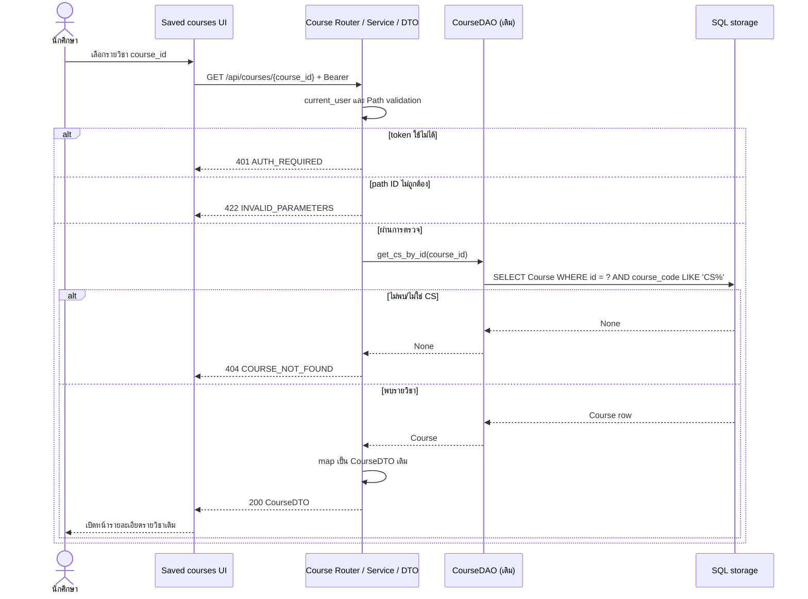
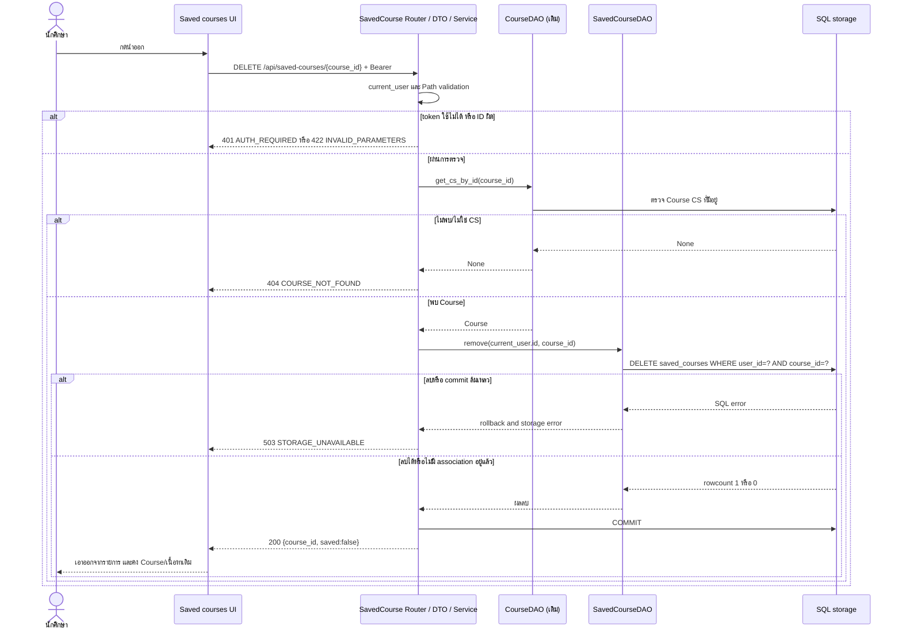

# Task104: U10 — แบบ DAO และลำดับการดู/เปิด/นำรายวิชาออก

**สถานะ:** Draft สำหรับ review — ใช้ Task94 API Contract รุ่น 0.2 เป็น baseline; Task94 ยังรอทีม review และ Task99 ยังรอ PO ยืนยัน
**วันที่จัดทำ:** 4 พฤศจิกายน 2569
**รุ่นเอกสาร:** 0.1

## 1. ขอบเขตและสมมติฐาน

แบบนี้ยึดความสามารถ U10 ใน Task104 และ endpoint ใน Task94: ผู้ใช้ที่ Login ดูรายวิชาที่บันทึก เปิดรายละเอียดรายวิชาด้วย API เดิม และนำรายวิชาออกจากรายการส่วนตัว การเปิดไม่สร้าง API ใหม่ และการนำออกไม่ลบ Course หรือเนื้อหา

Task99 ฉบับปัจจุบันยังมีคำถามที่ PO ต้องตัดสิน เพราะระบบเดิมเก็บ `SavedGuide` ด้วย `guide_id` ขณะที่ Task94 และ Task104 ระบุรายการรายวิชาด้วย `course_id` แบบนี้จึงออกแบบสำหรับ `SavedCourse` ที่ Task103 จัดเตรียม โดยถือว่า contract นี้เป็นข้อเสนอที่ยังต้อง review ไม่ได้อ้างว่า PO อนุมัติแล้ว

**สมมติฐานที่ Task103/Task94 ต้องตรวจร่วมกัน:** `SavedCourse` เชื่อม `user_id` กับ `course_id` ด้วย composite key; ใช้ `users.id` และ `courses.id` เดิม; ไม่รับ `user_id` จาก request; DAO ลบเฉพาะคู่ผู้ใช้ปัจจุบันกับรายวิชาที่ระบุ ถ้า Task103 ใช้ชื่อ field หรือ constraint ต่างกัน ให้แก้แบบนี้ก่อน implementation โดยไม่สร้างตาราง Course/User หรือ ER ซ้ำ

## 2. ข้อมูลและ ER เดิมที่นำมาใช้

ไม่เพิ่ม Entity `Course` หรือ `User` และไม่ทำ ER ภาพรวมซ้ำ อ้างอิงตารางเดิมจาก [Task22 Course Entity](../../U2/design/task22-course-entity.md), [Task6 User/DAO](../../U1/design/task6-db-er-entity-dao.md) และ [Task36 ER ของ Guide/Course](../../U3/design/task36-db-er-entity-dao.md)



แผนภาพเป็น fragment แสดงเฉพาะ relation ที่ U10 ใช้ ตารางและ field ของ `saved_courses` ต้องตรงกับ Entity/ตารางจาก Task103 ก่อน merge; ไม่ให้ Task104 สร้างตารางใหม่ซ้ำอีกชุด การลบ bookmark ต้องคง `courses`, `guides`, summaries และข้อมูลของผู้ใช้อื่นไว้

## 3. DAO และการแบ่งหน้าที่

| Component / method | Input | Output | หน้าที่และข้อผิดพลาด |
|---|---|---|---|
| `SavedCourseDAO.list_by_user(user_id)` | ID จาก `AuthenticatedUser` | `list[Course]` | Join `SavedCourse` กับ `Course` ด้วย `course_id`; filter `SavedCourse.user_id == user_id`; เรียง `course_code ASC, Course.id ASC`; คืน `[]` เมื่อไม่มีรายการ |
| `SavedCourseDAO.remove(user_id, course_id)` | ID ผู้ใช้จาก session และ ID จาก path | จำนวนแถวที่ลบ หรือ bool | DELETE ด้วยเงื่อนไขทั้ง `user_id` และ `course_id`; ไม่ delete Course; ศูนย์แถวคือ no-op ที่สำเร็จสำหรับการนำออกซ้ำ |
| `CourseDAO.get_cs_by_id(course_id)` (เดิม) | ID จาก path | `Course` หรือ `None` | ตรวจว่ารายวิชามีอยู่และเป็นวิชา CS ก่อนตอบสถานะ/นำออก; เปิดรายละเอียดใช้ Course API เดิม |
| `SavedCoursesService.list_for_user(user_id)` | Principal ที่ผ่าน `current_user` | `SavedCourseListResponse(items=[CourseRefDTO...])` | แปลง `Course` เป็น `{id, course_code, course_name}`; storage error แปลงเป็น `STORAGE_UNAVAILABLE` ไม่แปลงเป็นรายการว่าง |
| `SavedCoursesService.remove(user_id, course_id)` | Principal และ path ID ที่ validate แล้ว | `SavedCourseState(course_id, saved=False)` | ตรวจ Course CS ที่มีอยู่, ลบ association, commit; ถ้า DB error ให้ rollback แล้วคืน storage error |

DAO ไม่ commit transaction เอง ให้ Service ถือ session/transaction เดียวตามรูปแบบ dependencies ปัจจุบัน กรณี remove ซ้ำ Service commit no-op ได้และตอบ `{course_id, saved: false}` ตาม contract

### SQL เชิงแนวคิด

รายการ:

```sql
SELECT c.id, c.course_code, c.course_name
FROM saved_courses AS sc
JOIN courses AS c ON c.id = sc.course_id
WHERE sc.user_id = :current_user_id
ORDER BY c.course_code ASC, c.id ASC;
```

นำออก:

```sql
DELETE FROM saved_courses
WHERE user_id = :current_user_id
  AND course_id = :course_id;
```

ใช้ parameter binding ผ่าน SQLAlchemy ORM/Core; SQL นี้อธิบายขอบเขตการกรอง ไม่ใช่คำสั่งให้สร้างตารางใหม่

## 4. API/DTO และกติกา

อ้าง endpoint จาก Task94: `GET /api/saved-courses`, `DELETE /api/saved-courses/{course_id}` และ `GET /api/courses/{course_id}` เดิม ทุก endpoint ต้องผ่าน Bearer session; ไม่รับ owner ID ใน body/query

| ขั้นตอน | ผลสำเร็จ | กรณีผิดพลาด |
|---|---|---|
| ดูรายการ | `200 {"items": [{"id": 1, "course_code": "CS261", "course_name": "..."}]}`; ไม่มีรายการเป็น `200 {"items": []}` | ไม่มี/ผิด/หมดอายุ token: `401 AUTH_REQUIRED`; storage error: `503 STORAGE_UNAVAILABLE` |
| เปิดรายวิชา | UI ใช้ `CourseRefDTO.id` เรียก `GET /api/courses/{course_id}` ผ่าน proxy เดิม; ได้ Course DTO จาก API เดิม | ID ไม่ใช่จำนวนบวก: `422 INVALID_PARAMETERS`; วิชาไม่มีหรือไม่ใช่ CS: `404 COURSE_NOT_FOUND`; token ไม่ผ่าน: `401`; storage error ของ API เดิมเป็น `500 INTERNAL_ERROR` ตาม `CourseApiRoute` ปัจจุบัน |
| นำออก | ลบเฉพาะ association ของ current user แล้วตอบ `200 {"course_id": 1, "saved": false}`; เรียกซ้ำได้ผลเดิม | ID ผิด `422`; Course ไม่มี/ไม่ใช่ CS `404 COURSE_NOT_FOUND`; DB error `503 STORAGE_UNAVAILABLE` และ association ต้องยังอยู่ |

รายการ Course ที่บันทึกต้องแยกจาก `/api/saved-guides` ซึ่งบันทึก Guide คนละชนิด ถ้าระบบมี saved-course reference ที่ชี้ไป Course ที่ถูกลบ ให้ปฏิบัติตาม FK/ลำดับ cleanup ที่ Task103 กำหนด; GET list ต้องไม่คืนรายการที่เปิดต่อไม่ได้

## 5. Sequence Diagrams

ไฟล์ Mermaid ต้นฉบับแยกแก้ไขได้: [ER fragment](task104-saved-courses-er.mmd), [ดูรายการ](task104-saved-courses-list.mmd), [เปิดรายวิชา](task104-saved-courses-open.mmd), [นำออก](task104-saved-courses-remove.mmd). แผนภาพด้านล่างแสดง UI, API/DTO/Service, DAO, SQL และ storage พร้อมเส้นทางสำเร็จและข้อผิดพลาดสำคัญ

### 5.1 ดูรายการรายวิชาที่บันทึก



### 5.2 เปิดรายวิชาจากรายการ



### 5.3 นำรายวิชาออกจากรายการส่วนตัว



## 6. จุดทดสอบตามระดับ

รายการนี้เป็นแผนสำหรับผู้ implement/ผู้ทดสอบภายหลัง ไม่ใช่ผลรันทดสอบจริง

| ระดับ | ตรวจอะไร | กรณีสำคัญ |
|---|---|---|
| Unit — DAO | filter เจ้าของ, join Course, sort คงที่, delete แบบ composite predicate | ผู้ใช้ A/B มี bookmark course เดียวกัน; A remove แล้ว B ยังอยู่; remove ซ้ำ rowcount 0; list ว่าง |
| Unit — Service | DTO mapping, ตรวจ Course ก่อน remove, commit/rollback, error mapping | Course หาย/ไม่ใช่ CS; DB ล้มเหลวขณะอ่าน/ลบ/commit; error ห้ามกลายเป็น empty/false success |
| API | auth, validation, status/error envelope, DTO shape | ไม่มี/ผิด token 401; ID 0/ติดลบ/ไม่ใช่เลข 422; unknown/non-CS course 404; list 200; repeated DELETE 200 false |
| Integration | FK และ transaction บน SQL Server/DB ที่โครงการใช้จริง | remove A ไม่กระทบ bookmark B, Course, Guide/summary; forced rollback คง association; list order `course_code,id` |
| UI/API | เปิดรายการ, empty/error states, เปิดรายละเอียดผ่าน Course API เดิม, remove แล้ว refresh | 401 ไปหน้า Login ตาม flow เดิม; 503 แสดงล้มเหลวและไม่ซ่อนรายการ; เปิด Course ไม่เพิ่ม API ใหม่ |

## 7. Review และประเด็นค้าง

| รายการ | สถานะ |
|---|---|
| ตรวจ schema/model/DAO ที่มี และ ER อ้างอิง | ตรวจแล้ว: ปัจจุบันมี `SavedGuide`; ยังไม่พบ `SavedCourse` ใน branch นี้ จึงระบุ Task103 เป็น dependency และไม่อ้างว่า implementation มีแล้ว |
| ตรวจ endpoint/DTO/error กับ Task94 v0.2 | ตรวจเทียบแล้วในฐานะ draft; Task94 PR #103 ยังรอ Frontend/Backend/PO review |
| ตรวจความสอดคล้องกับ Task99/TC | พบ conflict ระหว่าง Guide bookmark ในระบบปัจจุบันกับ Course bookmark ใน Task94/Task104; ต้องให้ PO/ทีมยืนยันก่อนล็อก implementation |
| ตรวจข้อผิดพลาดของ Course API เดิม | ตรวจแล้ว: `CourseApiRoute` แปลง unhandled storage exception เป็น `500 INTERNAL_ERROR`; ไม่อ้างว่าเป็น `503` |
| ผู้ทบทวนอิสระ / วันที่ / revision ที่ตรวจ | รอ reviewer ของทีมกรอกหลัง review จริง; เอกสารนี้ยังไม่อ้าง independent review |

### Review checklist สำหรับ PR

- [ ] Task103 model/table และ key ตรงกับสมมติฐานในเอกสาร
- [ ] Frontend/Backend ยืนยัน endpoint, DTO และ empty/error behavior กับ Task94
- [ ] PO ยืนยัน scope Course bookmark เทียบกับ Task99
- [ ] Reviewer ตรวจ SQL ownership predicate, transaction และกรณีล้มเหลว; เติมชื่อ/วันที่/commit/review link และข้อแก้ไขจริง

## 8. แหล่งอ้างอิงใน Repository

- [Task94 API Contract (PR #103)](https://github.com/Lilieay/cs261-group4-100001/blob/docs/task94-api-contract/docs/task94-api-contract.md) — baseline ที่ยังรอ review
- [Task99 U10 Requirements/TC](../requirements/task99-u10-requirements-and-test-cases.md) — draft ที่ PO ยังไม่ยืนยัน
- [Course Entity/DAO](../../U2/design/task22-course-entity.md), [User Entity/DAO](../../U1/design/task6-db-er-entity-dao.md), [Guide/Course ER](../../U3/design/task36-db-er-entity-dao.md)
- Current implementation reference: `backend/app/models/saved_guide.py`, `backend/app/dao/saved_guide_dao.py`, `backend/app/routers/courses.py`, `backend/app/dao/course_dao.py`, `backend/app/services/courses.py`
- Target implementation reference: `SavedCourse` จาก Task103 (ยังไม่พบใน branch `U10` ที่ตรวจ)
