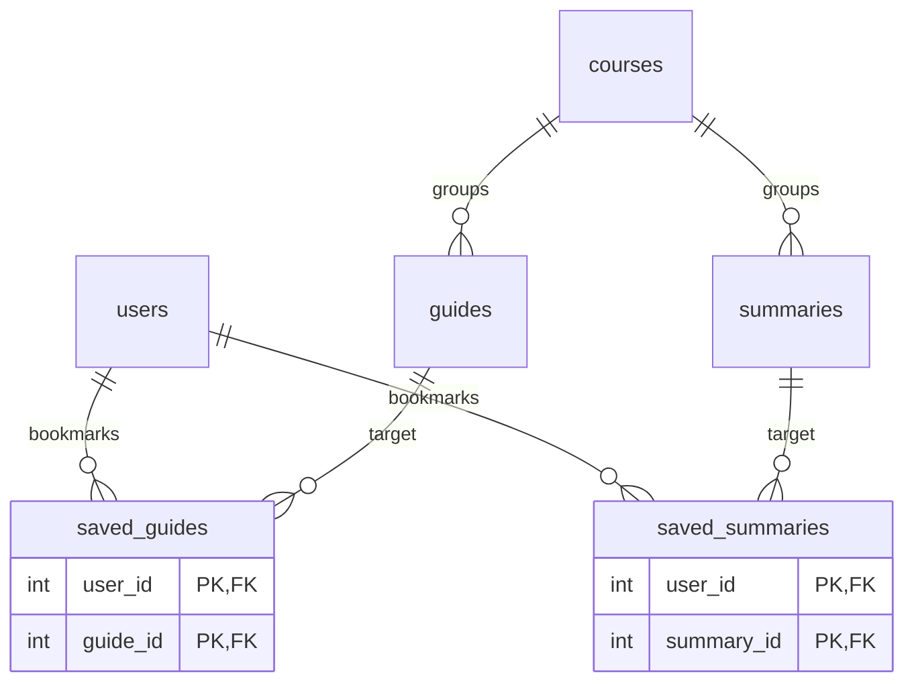
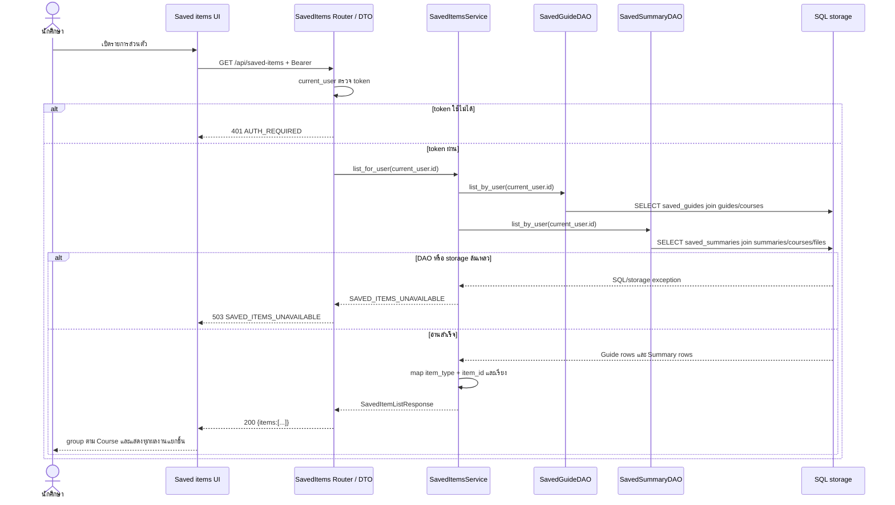
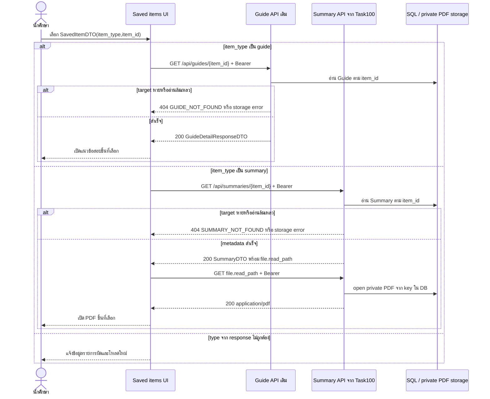
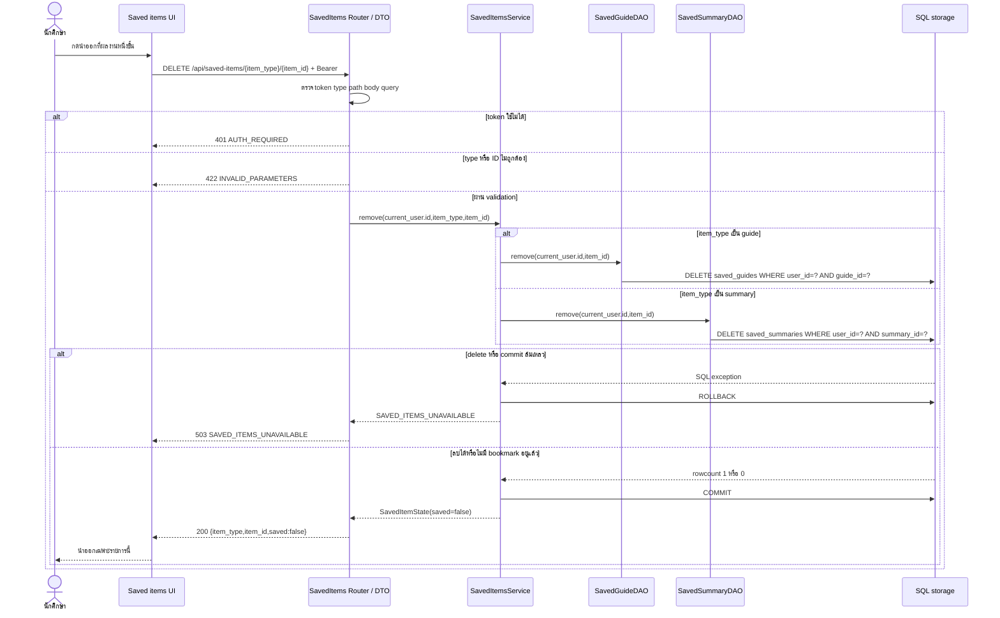

# Task104 U10 แบบ DAO และลำดับการดู เปิด และนำผลงานออก

**สถานะ:** แก้ตามข้อพบรอบ review แล้ว พร้อมส่งตรวจซ้ำ โดยยังห้ามเริ่ม implementation จน contract และ data model ที่เกี่ยวข้องผ่าน DoD

**วันที่จัดทำ:** 4 พฤศจิกายน 2569

**วันที่แก้ไขล่าสุด:** 14 พฤศจิกายน 2569

**รุ่นเอกสาร:** 0.3

## 1 ขอบเขตและมติที่ใช้แก้แบบ

U10 บันทึก **ผลงานทีละชิ้น** แล้วให้ UI จัดกลุ่มตามรายวิชา ไม่ได้บันทึกรายวิชาทั้งก้อน ผลงานที่รองรับในขอบเขตนี้มี 2 ชนิด ได้แก่ แนวข้อสอบ (`guide`) และสรุป PDF (`summary`) ดังนั้นรหัสรายวิชาใช้สำหรับจัดกลุ่มและแสดงผลเท่านั้น ไม่ใช่ identity ของ bookmark

ข้อพบจาก review วันที่ 14 พฤศจิกายน 2569 ชี้ว่าแบบเดิมที่ใช้ `SavedCourse(user_id, course_id)` เปิดผลงานที่เลือกไม่แน่นอนเมื่อวิชาเดียวกันมีหลายผลงาน รุ่น 0.3 จึงเปลี่ยน identity เป็นคู่ `item_type + item_id` และให้ Backend สร้างเส้นทางเปิดจากชนิดผลงานที่ตรวจแล้ว

การนำออกต้องลบเฉพาะ bookmark ที่ตรงกับ **ผู้ใช้ปัจจุบัน ชนิดผลงาน และรหัสผลงาน** ไม่ลบ Guide, Summary, PDF, Course หรือ bookmark ของผู้ใช้อื่น การนำออกซ้ำเป็น idempotent และตอบสถานะ `saved: false` เหมือนเดิม

### Dependency gate ก่อนเริ่ม implementation

| งานก่อนหน้า | หลักฐานที่ตรวจ | สถานะ ณ 14 พฤศจิกายน 2569 | ผลต่อ Task104 |
|---|---|---|---|
| Task94 API Contract กลาง U6–U10 | `origin/docs/task94-api-contract`, commit `de3e669` | Contract เดิมใช้ saved course และต้องแก้เป็น saved item | ต้องยืนยัน route, DTO และ error ใหม่ร่วมกับ Frontend/Backend |
| Task99 รายละเอียดและ Test Cases U10 | `origin/U10` และ `origin/feat/u10-task99-requirements`, commit `cc5b928` | Review ยืนยันให้บันทึกผลงานรายชิ้นและเปิดชิ้นที่เลือก | ใช้เป็นมติแก้แบบรุ่น 0.3 |
| Task100 แบบ Summary และ PDF storage | `origin/docs/task100-u6-pdf-design` | มี identity ของ Summary และเส้นทางอ่าน PDF แต่ยังรอ review | ใช้อ้าง `summary_id` และ API เปิดสรุปแบบมีเงื่อนไข |
| งาน data model ของ saved item | ยังไม่พบ artefact ที่ยืนยัน `SavedSummary` ใน `sprint2` | มี `SavedGuide` เดิม แต่ยังไม่มี relation สำหรับ Summary | เจ้าของ data model ต้องกำหนด table/constraint จริง ห้าม Task104 สร้าง `SavedCourse` หรือ schema ซ้ำ |

เอกสารนี้เป็นแบบสำหรับ review ไม่ถือว่า dependency ผ่าน DoD หรือเริ่ม implementation แล้ว

## 2 ข้อมูลและ ER เดิมที่นำมาใช้

ใช้ `users`, `courses`, `guides`, `summaries` และ `saved_guides` เดิม ไม่สร้าง User, Course, Guide หรือ Summary ซ้ำ แบบเสนอให้ data-model task เพิ่ม relation ของ Summary ในชื่อเชิงตรรกะ `saved_summaries` โดยใช้ FK จริงไปยัง `summaries.id`

ไม่ใช้ตาราง polymorphic แบบ `saved_items(user_id, item_type, item_id)` เพราะ `item_id` ไม่สามารถเป็น FK ไปทั้ง Guide และ Summary ได้อย่างปลอดภัย และ Guide กับ Summary อาจมี ID ตัวเลขเดียวกัน การแยก relation ตามชนิดทำให้ฐานข้อมูลบังคับ referential integrity และ cascade ของ target ที่ถูกลบได้



ไฟล์ต้นฉบับ: [ER fragment](task104-saved-items-er.mmd)

`saved_guides` เป็นของระบบเดิม ส่วนชื่อและ constraint จริงของ `saved_summaries` ต้องตรงกับ data-model task ก่อน merge แบบ การลบ target โดยงานที่มีสิทธิ์ให้ relation ของ target นั้นถูก cleanup ตาม FK แต่ห้ามกระทบ target ชนิดอื่นที่บังเอิญมีเลข ID เท่ากัน

## 3 DAO Service และ DTO

| Component หรือ method | Input | Output | หน้าที่และข้อผิดพลาด |
|---|---|---|---|
| `SavedGuideDAO.list_by_user(user_id)` | ID จาก authenticated principal | `list[Guide]` พร้อม Course | filter ด้วย `saved_guides.user_id`; DB error ต้องส่งออก ไม่คืน `[]` แทน error |
| `SavedSummaryDAO.list_by_user(user_id)` | ID จาก authenticated principal | `list[Summary]` พร้อม Course และ file metadata ที่จำเป็น | filter ด้วย `saved_summaries.user_id`; ไม่อ่าน PDF bytes ใน list |
| `SavedGuideDAO.remove(user_id, guide_id)` | ID ผู้ใช้จาก session และ Guide ID ที่ validate แล้ว | rowcount 0 หรือ 1 | DELETE ด้วย predicate ทั้งสองค่า ไม่ลบ Guide |
| `SavedSummaryDAO.remove(user_id, summary_id)` | ID ผู้ใช้จาก session และ Summary ID ที่ validate แล้ว | rowcount 0 หรือ 1 | DELETE ด้วย predicate ทั้งสองค่า ไม่ลบ Summary หรือ PDF |
| `SavedItemsService.list_for_user(user_id)` | Principal ที่ผ่าน `current_user` | `SavedItemListResponse(items=[SavedItemDTO...])` | รวมผล 2 DAO, map DTO, เรียงและให้ UI group ตาม Course; ถ้า DAO ใดล้มเหลวต้องตอบ storage error ทั้งรายการ |
| `SavedItemsService.remove(user_id, item_type, item_id)` | Principal, enum `guide` หรือ `summary`, positive ID | `SavedItemState(item_type, item_id, saved=False)` | dispatch ไป DAO ที่ตรงชนิด, commit; SQL/commit error rollback |

DAO ไม่ commit เอง Service คุม transaction และไม่รับ `user_id` จาก body/query `item_type` เป็น enum ปิด ไม่รับชื่อตารางหรือชื่อ model จาก client

### SavedItemDTO

```json
{
  "item_type": "guide",
  "item_id": 41,
  "course": {"id": 7, "course_code": "CS261", "course_name": "..."},
  "title": "แนวข้อสอบกลางภาค",
  "open_path": "/api/guides/41"
}
```

สำหรับ `summary` ใช้ `item_type: "summary"` และ `open_path: "/api/summaries/{item_id}"` โดย DTO ของ Summary ส่ง `file.read_path` สำหรับเปิด PDF ต่อ Backend เป็นผู้สร้าง path จากชนิดและ ID ที่อ่านจาก DB ห้ามใช้ URL หรือ storage key จาก request

รายการเรียง `course.course_code ASC, item_type ASC, item_id DESC` เพื่อให้ผลคงที่ แล้ว UI แสดงหัวข้อกลุ่มตาม Course ผลงานสองชิ้นในวิชาเดียวกันต้องคงเป็นคนละรายการ

### SQL เชิงแนวคิด

รายการ Guide bookmark:

```sql
SELECT g.*, c.course_code, c.course_name
FROM saved_guides AS sg
JOIN guides AS g ON g.id = sg.guide_id
JOIN courses AS c ON c.id = g.course_id
WHERE sg.user_id = :current_user_id;
```

รายการ Summary bookmark:

```sql
SELECT s.*, c.course_code, c.course_name, sf.original_name, sf.content_type, sf.size_bytes
FROM saved_summaries AS ss
JOIN summaries AS s ON s.id = ss.summary_id
JOIN courses AS c ON c.id = s.course_id
JOIN summary_files AS sf ON sf.summary_id = s.id
WHERE ss.user_id = :current_user_id;
```

นำออกตามชนิด:

```sql
DELETE FROM saved_guides
WHERE user_id = :current_user_id AND guide_id = :item_id;

DELETE FROM saved_summaries
WHERE user_id = :current_user_id AND summary_id = :item_id;
```

ใช้ parameter binding ผ่าน SQLAlchemy และรันเพียงคำสั่งของชนิดที่ผ่าน enum validation ห้ามสร้าง SQL จากข้อความ `item_type`

## 4 API และกติกาข้อผิดพลาด

แบบเสนอสำหรับ Task94 รุ่นถัดไป:

| ขั้นตอน | Endpoint | ผลสำเร็จ | กรณีผิดพลาด |
|---|---|---|---|
| ดูรายการ | `GET /api/saved-items` | `200 {"items":[SavedItemDTO...]}`; ไม่มีรายการเป็น `items: []` | Token ใช้ไม่ได้ `401 AUTH_REQUIRED`; DB error `503 SAVED_ITEMS_UNAVAILABLE` |
| เปิดแนวข้อสอบ | `GET /api/guides/{item_id}` | `200 GuideDetailResponseDTO` ของ ID ที่เลือก | ID ผิด `422`; ไม่มี target `404 GUIDE_NOT_FOUND`; storage error ตาม Guide API |
| เปิดสรุป PDF | `GET /api/summaries/{item_id}` แล้วใช้ `file.read_path` | `200 SummaryDTO` และ `200 application/pdf` | ID ผิด `422`; ไม่มี target `404 SUMMARY_NOT_FOUND`; DB/storage errorตาม Summary API |
| นำออก | `DELETE /api/saved-items/{item_type}/{item_id}` | `200 {"item_type":"guide","item_id":41,"saved":false}`; เรียกซ้ำได้ผลเดิม | type/ID/body/query ผิด `422 INVALID_PARAMETERS`; DB/commit error `503 SAVED_ITEMS_UNAVAILABLE` |

ทุก endpoint ตรวจ Login ก่อนเปิดเผยข้อมูล ไม่รับ owner ID จาก client การนำออกของผู้ใช้ B ใช้ `user_id` ของ B เสมอ จึงเอา bookmark ของ A ออกไม่ได้และไม่ตอบ `403` ที่เปิดเผยข้อมูลของ A

ถ้า target ถูกลบและ FK cleanup bookmark แล้ว การนำออกซ้ำยังตอบ `saved: false` ได้ ส่วนการเปิด target ที่หายตอบ 404 และ UI โหลดรายการใหม่ ห้ามเปลี่ยน DB error เป็นรายการว่างหรือ success

## 5 Sequence Diagrams

ไฟล์ Mermaid ที่แก้ไขได้:

- [ดูรายการ](task104-saved-items-list.mmd)
- [เปิดผลงาน](task104-saved-items-open.mmd)
- [นำออก](task104-saved-items-remove.mmd)

### 5.1 ดูรายการและจัดกลุ่มตามวิชา



### 5.2 เปิดผลงานที่เลือก



### 5.3 นำ bookmark ของผู้ใช้ปัจจุบันออก



## 6 จุดทดสอบตามระดับ

รายการนี้เป็นแผนสำหรับผู้ implement และผู้ทดสอบภายหลัง ไม่ใช่ผลรันทดสอบจริง

| ระดับ | ตรวจอะไร | กรณีสำคัญ |
|---|---|---|
| Unit DAO | owner predicate, target predicate, join Course, rowcount | A/B bookmark target เดียวกัน; A remove แล้ว B ยังอยู่; remove ซ้ำ rowcount 0 |
| Unit Service | dispatch ตาม enum, DTO mapping, sort, commit/rollback | Guide ID 7 กับ Summary ID 7 ไม่ชนกัน; DAO ตัวใดล้มเหลวต้องไม่คืน list บางส่วน |
| API | auth, enum/ID validation, response shape, idempotent remove | token ผิด 401; type แปลก/ID 0 422; repeated DELETE 200 false |
| Integration | FK/cascade และ transaction บน SQL Server | ลบ bookmark ไม่ลบ target/PDF/Course; A ไม่กระทบ B; rollback คง bookmark |
| UI/API | grouping และเปิด exact target | วิชาเดียวมี Guide 2 ชิ้นและ Summary 2 ชิ้น; กดแต่ละรายการต้องเปิด ID และชนิดที่เลือก |

## 7 Review และประเด็นค้าง

| รายการ | สถานะ |
|---|---|
| แก้ identity จาก Course เป็นผลงาน | แก้แล้วในรุ่น 0.3 ใช้ `item_type + item_id`; Course เหลือหน้าที่ grouping |
| ป้องกันลบข้อมูลข้ามผู้ใช้ | DAO DELETE มี `user_id` จาก authenticated principal และ target ID ใน predicate |
| ป้องกันลบผลงานจริง | DAO ลบเฉพาะ relation `saved_guides` หรือ `saved_summaries` ไม่ DELETE target table |
| รองรับ Guide และ Summary ID ซ้ำกัน | แยก relation ตามชนิดและ DTO มี `item_type`; ไม่ใช้ polymorphic FK ร่วม |
| สอดคล้องกับ Task94 | ยังต้องแก้ contract จาก `/api/saved-courses` เป็น saved item และ review ร่วม Frontend/Backend |
| สอดคล้องกับ Summary data model | อ้างแบบ Task100; รอยืนยันชื่อ table/FK ของ Summary bookmark จาก data-model task |
| ผู้ทบทวนอิสระและผลตรวจซ้ำ | รอ reviewer ตรวจรุ่น 0.3 และบันทึกชื่อ วันที่ commit และมติจริง |

### ประวัติรุ่นและบันทึก review

| รุ่น | วันที่ | ผู้จัดทำหรือผู้ตรวจ | รายการเปลี่ยนแปลงหรือผลตรวจ |
|---|---|---|---|
| 0.1 | 4 พฤศจิกายน 2569 | ผู้จัดทำแบบ | ร่าง DAO, SQL, ER fragment และ 3 sequence flows |
| 0.2 | 13 พฤศจิกายน 2569 | ผู้จัดทำแบบ | เพิ่ม dependency gate, validation, rollback และ storage error paths |
| 0.3 | 14 พฤศจิกายน 2569 | ผู้จัดทำแบบตามข้อพบจาก reviewer | เปลี่ยนจาก SavedCourse เป็น bookmark ระดับ Guide/Summary; เปิด exact target; remove เฉพาะ current user; เพิ่ม test กรณี ID ชนกัน |
| Review ซ้ำ | รอกรอก | ชื่อ reviewer วันที่ commit | บันทึกผลยอมรับและข้อแก้จริงก่อนปิด Task104 |

### Review checklist สำหรับ PR

- [x] Course ใช้ grouping เท่านั้น และผลงานแต่ละชิ้นมี `item_type + item_id`
- [x] DAO remove กรองทั้ง current user และ target ที่เลือก
- [x] Sequence list/open/remove แสดง Guide และ Summary แยกชิ้น
- [x] ระบุว่าห้ามลบ Guide, Summary, PDF, Course และ bookmark ของผู้อื่น
- [ ] Task94 ยืนยัน route/DTO/error ของ saved item
- [ ] Data-model task ยืนยัน `saved_summaries` table, key, FK และ cleanup policy
- [ ] Reviewer ตรวจรุ่น 0.3 และบันทึกชื่อ วันที่ commit ผลตรวจ

## 8 แหล่งอ้างอิงใน Repository

- Task99 U10 requirements and tests: `docs/U10/requirements/task99-u10-requirements-and-test-cases.md` จาก PR #102
- Task100 Summary/PDF design: `docs/U6/design/task100-u6-pdf-backend-design.md` จาก branch `origin/docs/task100-u6-pdf-design`
- Task101 Summary management design: `docs/U7/design/task101-u7-dao-design.md` จาก branch `origin/docs/task101-u7-dao-design`
- Current Guide bookmark implementation: `backend/app/models/saved_guide.py`, `backend/app/dao/saved_guide_dao.py`, `backend/app/services/saved_guides.py`, `backend/app/routers/saved_guides.py`
- Existing target APIs: `backend/app/routers/guides.py`, `backend/app/routers/courses.py`
