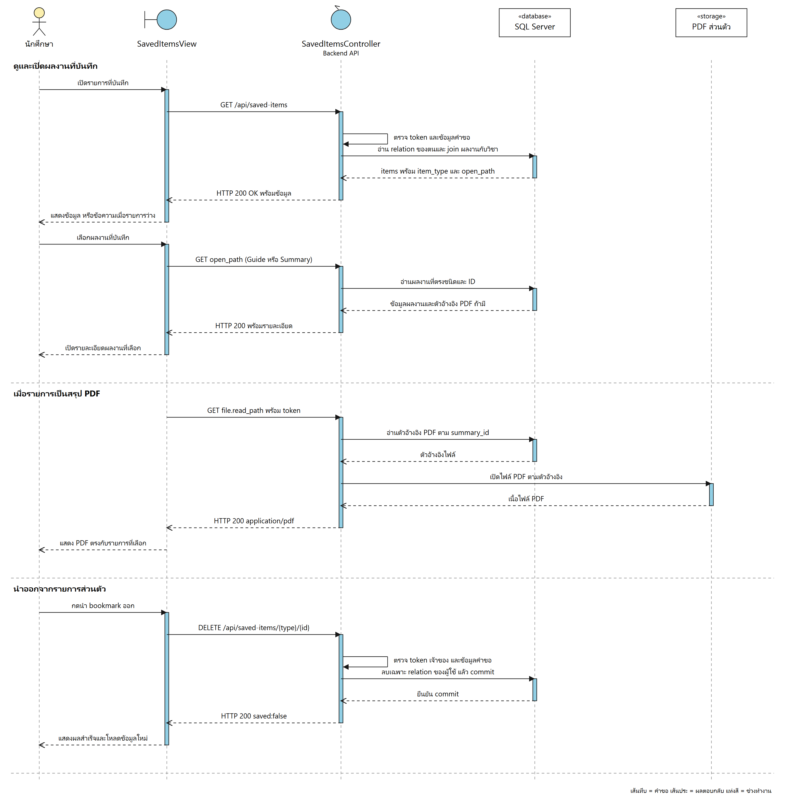
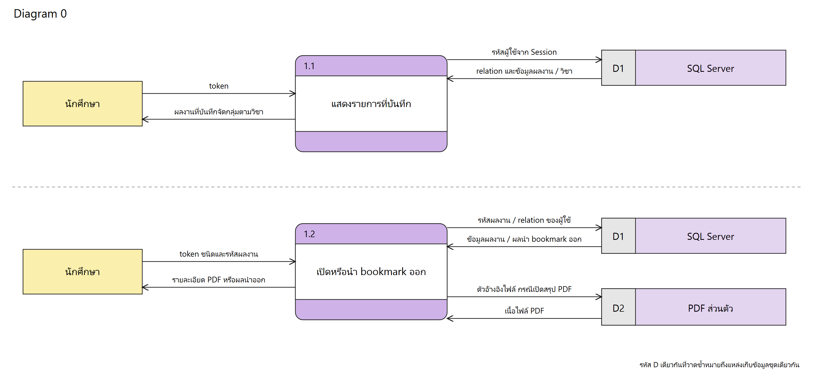

# U10 ดู เปิด และนำผลงานที่บันทึกออก

แผนภาพสำหรับอธิบายการทำงานของระบบ ใช้สีและสัญลักษณ์ตามชุด U6

## ระบบนี้ช่วยอะไร

ดู เปิด และนำผลงานที่บันทึกออก ผ่านหน้าเว็บที่เชื่อมกับ Backend และข้อมูลของระบบ

## UML Sequence Diagram

อ่านจากบนลงล่าง เส้นทึบคือคำขอ เส้นประคือผลตอบกลับ แท่งสีแสดงช่วงทำงาน ชื่อ View รวมหน้าเว็บและ JavaScript ส่วน Controller รวม Router, Service และ DAO; คำขอผ่าน Node proxy แต่ไม่แยกเป็น lifeline ภาพเน้นเส้นทางสำเร็จ รายละเอียด error อยู่ในเอกสารออกแบบเดิม

หน้า UI จัดกลุ่มผลงานตามวิชา แต่เปิดและนำออกทีละ Guide/Summary ไม่ลบรายวิชาหรือผลงานต้นฉบับ การนำออกซ้ำเป็น saved:false เหมือนเดิม ไม่กระทบ bookmark คนอื่น การเปิด PDF เรียก Summary detail แล้ว GET file.read_path พร้อม token ตาม U6

## Dataflow Diagram

กล่องสีเหลืองคือนักศึกษาหรือระบบภายนอก กล่อง process สีม่วงแสดงงาน ลูกศรระบุข้อมูลที่ส่งระหว่างกัน รหัส D เดียวกันที่วาดซ้ำหมายถึงแหล่งข้อมูลชุดเดียวกัน การตรวจ token อยู่ที่ขอบเขต Backend ตาม U1 ไม่ได้วาดซ้ำทุก process

**1.1 แสดงรายการที่บันทึก** รับ token แล้วส่งกลับ ผลงานที่บันทึกจัดกลุ่มตามวิชา โดยอ่านหรือเปลี่ยนข้อมูลตามลูกศรในภาพ

**1.2 เปิดหรือนำ bookmark ออก** รับ token ชนิดและรหัสผลงาน แล้วส่งกลับ รายละเอียด PDF หรือผลนำออก โดยอ่านหรือเปลี่ยนข้อมูลตามลูกศรในภาพ

## ไฟล์อ้างอิง

- [saved_items.py](../../../backend/app/routers/saved_items.py)
- [saved_items.py](../../../backend/app/services/saved_items.py)
- [saved-courses.js](../../../frontend/public/js/saved-courses.js)
- [task104-saved-items-dao-and-sequences.md](task104-saved-items-dao-and-sequences.md)
- [SVG Sequence ที่แก้ไขได้](diagrams/u10-sequence.svg)
- [SVG Dataflow ที่แก้ไขได้](diagrams/u10-dataflow.svg)
