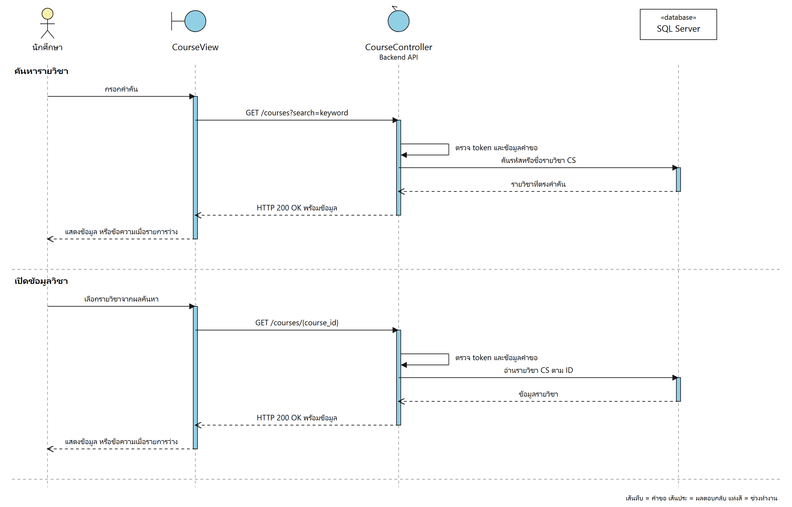
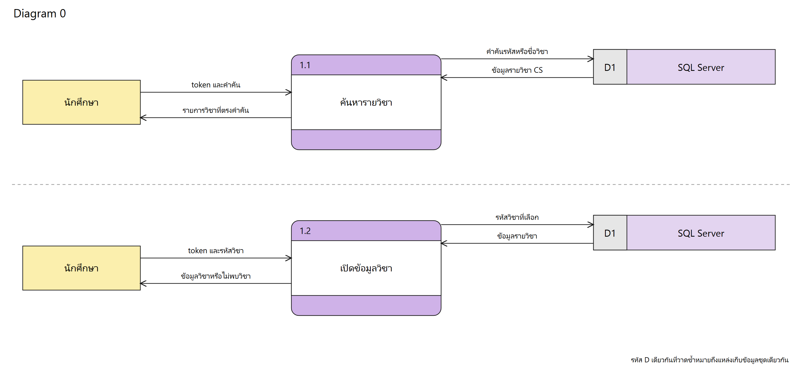

# U2 ค้นหาและเปิดรายวิชา CS

แผนภาพสำหรับอธิบายการทำงานของระบบ ใช้สีและสัญลักษณ์ตามชุด U6

## ระบบนี้ช่วยอะไร

ค้นหาและเปิดรายวิชา CS ผ่านหน้าเว็บที่เชื่อมกับ Backend และข้อมูลของระบบ

## UML Sequence Diagram

อ่านจากบนลงล่าง เส้นทึบคือคำขอ เส้นประคือผลตอบกลับ แท่งสีแสดงช่วงทำงาน ชื่อ View รวมหน้าเว็บและ JavaScript ส่วน Controller รวม Router, Service และ DAO; คำขอผ่าน Node proxy แต่ไม่แยกเป็น lifeline ภาพเน้นเส้นทางสำเร็จ รายละเอียด error อยู่ในเอกสารออกแบบเดิม

ใช้ endpoint ฝั่ง Backend ในภาพ คำค้นว่างคืนวิชา CS ทั้งหมด ผลค้นหาว่างเป็น 200 [] ไม่สร้างวิชาใหม่จากคำค้น; เปิดวิชาไม่พบเป็น 404 และ Session ใช้ไม่ได้เป็น 401

## Dataflow Diagram

กล่องสีเหลืองคือนักศึกษาหรือระบบภายนอก กล่อง process สีม่วงแสดงงาน ลูกศรระบุข้อมูลที่ส่งระหว่างกัน รหัส D เดียวกันที่วาดซ้ำหมายถึงแหล่งข้อมูลชุดเดียวกัน การตรวจ token อยู่ที่ขอบเขต Backend ตาม U1 ไม่ได้วาดซ้ำทุก process

**1.1 ค้นหารายวิชา** รับ token และคำค้น แล้วส่งกลับ รายการวิชาที่ตรงคำค้น โดยอ่านหรือเปลี่ยนข้อมูลตามลูกศรในภาพ

**1.2 เปิดข้อมูลวิชา** รับ token และรหัสวิชา แล้วส่งกลับ ข้อมูลวิชาหรือไม่พบวิชา โดยอ่านหรือเปลี่ยนข้อมูลตามลูกศรในภาพ

## ไฟล์อ้างอิง

- [courses.py](../../../backend/app/routers/courses.py)
- [courses.py](../../../backend/app/services/courses.py)
- [task23-course-search-sequence-diagram.md](task23-course-search-sequence-diagram.md)
- [SVG Sequence ที่แก้ไขได้](diagrams/u2-sequence.svg)
- [SVG Dataflow ที่แก้ไขได้](diagrams/u2-dataflow.svg)
