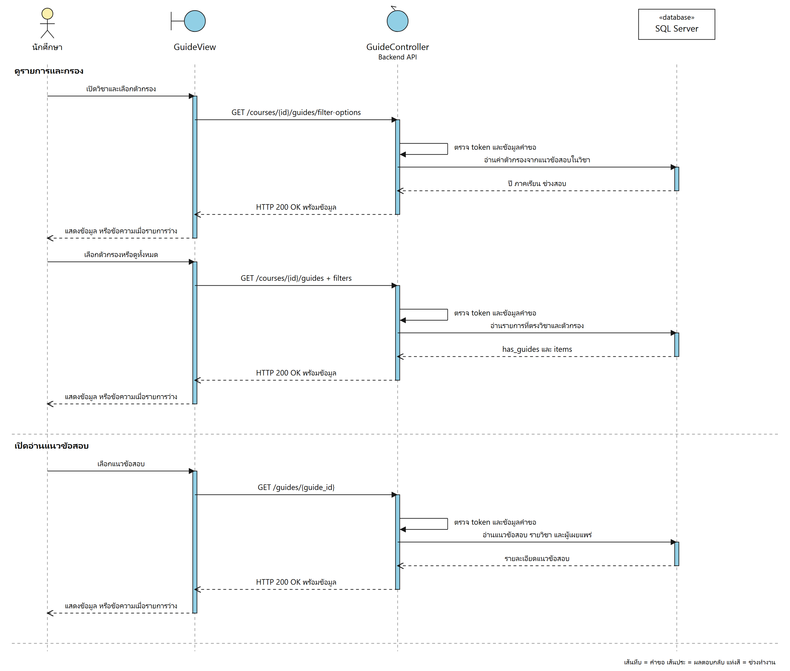
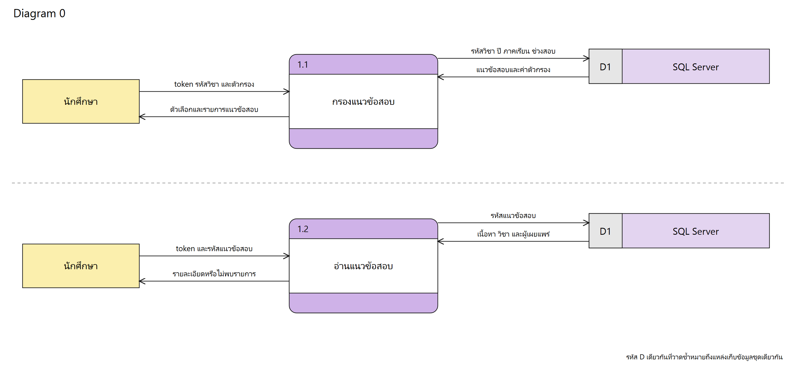

# U3 ดูรายการ กรอง และอ่านแนวข้อสอบ

แผนภาพสำหรับอธิบายการทำงานของระบบ ใช้สีและสัญลักษณ์ตามชุด U6

## ระบบนี้ช่วยอะไร

ดูรายการ กรอง และอ่านแนวข้อสอบ ผ่านหน้าเว็บที่เชื่อมกับ Backend และข้อมูลของระบบ

## UML Sequence Diagram

อ่านจากบนลงล่าง เส้นทึบคือคำขอ เส้นประคือผลตอบกลับ แท่งสีแสดงช่วงทำงาน ชื่อ View รวมหน้าเว็บและ JavaScript ส่วน Controller รวม Router, Service และ DAO; คำขอผ่าน Node proxy แต่ไม่แยกเป็น lifeline ภาพเน้นเส้นทางสำเร็จ รายละเอียด error อยู่ในเอกสารออกแบบเดิม

ภาพใช้ endpoint Backend หน้าเว็บส่งผ่าน Node proxy /api/guides/... ค่า has_guides=false แปลว่าวิชายังไม่มีแนวข้อสอบ; has_guides=true กับ items=[] แปลว่าไม่ตรงตัวกรอง รายการถูกลบระหว่างทางตอบ 404

## Dataflow Diagram

กล่องสีเหลืองคือนักศึกษาหรือระบบภายนอก กล่อง process สีม่วงแสดงงาน ลูกศรระบุข้อมูลที่ส่งระหว่างกัน รหัส D เดียวกันที่วาดซ้ำหมายถึงแหล่งข้อมูลชุดเดียวกัน การตรวจ token อยู่ที่ขอบเขต Backend ตาม U1 ไม่ได้วาดซ้ำทุก process

**1.1 กรองแนวข้อสอบ** รับ token รหัสวิชา และตัวกรอง แล้วส่งกลับ ตัวเลือกและรายการแนวข้อสอบ โดยอ่านหรือเปลี่ยนข้อมูลตามลูกศรในภาพ

**1.2 อ่านแนวข้อสอบ** รับ token และรหัสแนวข้อสอบ แล้วส่งกลับ รายละเอียดหรือไม่พบรายการ โดยอ่านหรือเปลี่ยนข้อมูลตามลูกศรในภาพ

## ไฟล์อ้างอิง

- [guides.py](../../../backend/app/routers/guides.py)
- [read_guide.py](../../../backend/app/services/read_guide.py)
- [task37-sequence-diagram.md](task37-sequence-diagram.md)
- [SVG Sequence ที่แก้ไขได้](diagrams/u3-sequence.svg)
- [SVG Dataflow ที่แก้ไขได้](diagrams/u3-dataflow.svg)
