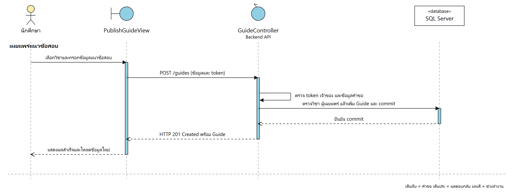
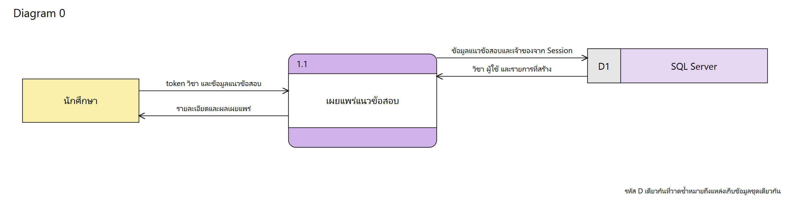

# U4 เผยแพร่แนวข้อสอบ

แผนภาพสำหรับอธิบายการทำงานของระบบ ใช้สีและสัญลักษณ์ตามชุด U6

## ระบบนี้ช่วยอะไร

เผยแพร่แนวข้อสอบ ผ่านหน้าเว็บที่เชื่อมกับ Backend และข้อมูลของระบบ

## UML Sequence Diagram

อ่านจากบนลงล่าง เส้นทึบคือคำขอ เส้นประคือผลตอบกลับ แท่งสีแสดงช่วงทำงาน ชื่อ View รวมหน้าเว็บและ JavaScript ส่วน Controller รวม Router, Service และ DAO; คำขอผ่าน Node proxy แต่ไม่แยกเป็น lifeline ภาพเน้นเส้นทางสำเร็จ รายละเอียด error อยู่ในเอกสารออกแบบเดิม

หน้าเว็บเรียก POST /api/guides แล้ว Node proxy ส่งต่อ POST /guides เจ้าของมาจาก Session ไม่รับ publisher_id จากฟอร์ม รายการนี้เป็นเนื้อหาแนวข้อสอบ ไม่ใช่การอัปโหลด PDF แบบ U6; network timeout ต้องตรวจรายการก่อนส่งซ้ำ

## Dataflow Diagram

กล่องสีเหลืองคือนักศึกษาหรือระบบภายนอก กล่อง process สีม่วงแสดงงาน ลูกศรระบุข้อมูลที่ส่งระหว่างกัน รหัส D เดียวกันที่วาดซ้ำหมายถึงแหล่งข้อมูลชุดเดียวกัน การตรวจ token อยู่ที่ขอบเขต Backend ตาม U1 ไม่ได้วาดซ้ำทุก process

**1.1 เผยแพร่แนวข้อสอบ** รับ token วิชา และข้อมูลแนวข้อสอบ แล้วส่งกลับ รายละเอียดและผลเผยแพร่ โดยอ่านหรือเปลี่ยนข้อมูลตามลูกศรในภาพ

## ไฟล์อ้างอิง

- [guides.py](../../../backend/app/routers/guides.py)
- [publish_guide.py](../../../backend/app/services/publish_guide.py)
- [task53-publish-guide-sequence-diagram.md](task53-publish-guide-sequence-diagram.md)
- [SVG Sequence ที่แก้ไขได้](diagrams/u4-sequence.svg)
- [SVG Dataflow ที่แก้ไขได้](diagrams/u4-dataflow.svg)
