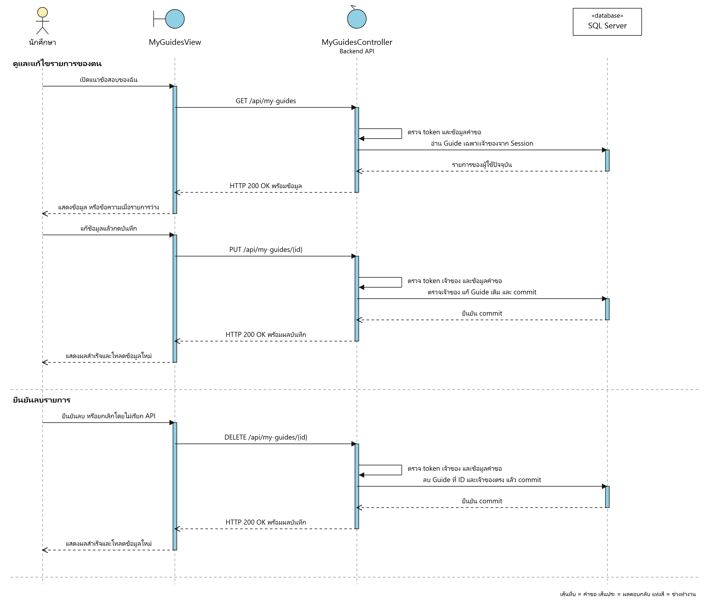
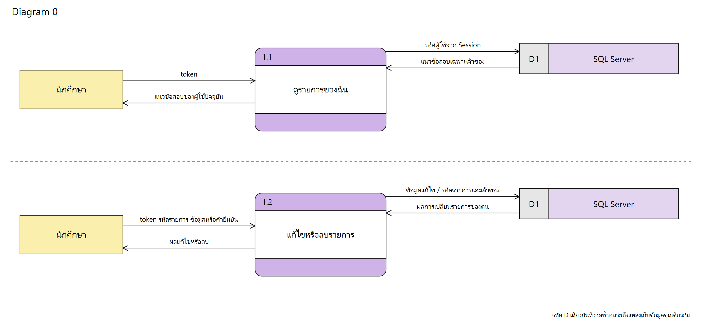

# U5 ดู แก้ไข และลบแนวข้อสอบของตน

แผนภาพสำหรับอธิบายการทำงานของระบบ ใช้สีและสัญลักษณ์ตามชุด U6

## ระบบนี้ช่วยอะไร

ดู แก้ไข และลบแนวข้อสอบของตน ผ่านหน้าเว็บที่เชื่อมกับ Backend และข้อมูลของระบบ

## UML Sequence Diagram

อ่านจากบนลงล่าง เส้นทึบคือคำขอ เส้นประคือผลตอบกลับ แท่งสีแสดงช่วงทำงาน ชื่อ View รวมหน้าเว็บและ JavaScript ส่วน Controller รวม Router, Service และ DAO; คำขอผ่าน Node proxy แต่ไม่แยกเป็น lifeline ภาพเน้นเส้นทางสำเร็จ รายละเอียด error อยู่ในเอกสารออกแบบเดิม

DELETE ในภาพเกิดเมื่อผู้ใช้ยืนยันเท่านั้น การยกเลิกไม่ส่ง API การแก้ไขคง ID/เจ้าของเดิม และอาจเปลี่ยนวิชาได้ รายการของคนอื่นไม่ถูกแก้หรือลบ หากยืนยันผลเครือข่ายไม่ได้ต้องโหลดรายการใหม่ก่อนลองซ้ำ

## Dataflow Diagram

กล่องสีเหลืองคือนักศึกษาหรือระบบภายนอก กล่อง process สีม่วงแสดงงาน ลูกศรระบุข้อมูลที่ส่งระหว่างกัน รหัส D เดียวกันที่วาดซ้ำหมายถึงแหล่งข้อมูลชุดเดียวกัน การตรวจ token อยู่ที่ขอบเขต Backend ตาม U1 ไม่ได้วาดซ้ำทุก process

**1.1 ดูรายการของฉัน** รับ token แล้วส่งกลับ แนวข้อสอบของผู้ใช้ปัจจุบัน โดยอ่านหรือเปลี่ยนข้อมูลตามลูกศรในภาพ

**1.2 แก้ไขหรือลบรายการ** รับ token รหัสรายการ ข้อมูลหรือคำยืนยัน แล้วส่งกลับ ผลแก้ไขหรือลบ โดยอ่านหรือเปลี่ยนข้อมูลตามลูกศรในภาพ

## ไฟล์อ้างอิง

- [my_guides.py](../../../backend/app/routers/my_guides.py)
- [my_guide_updates.py](../../../backend/app/routers/my_guide_updates.py)
- [my_guide_deletions.py](../../../backend/app/routers/my_guide_deletions.py)
- [task66-my-guides-management-sequence-diagram.md](task66-my-guides-management-sequence-diagram.md)
- [SVG Sequence ที่แก้ไขได้](diagrams/u5-sequence.svg)
- [SVG Dataflow ที่แก้ไขได้](diagrams/u5-dataflow.svg)
