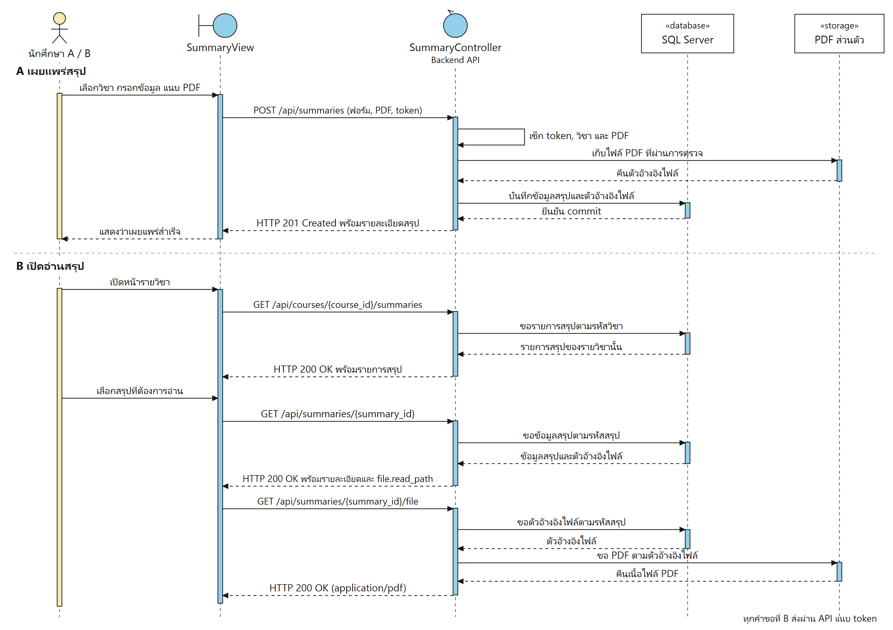
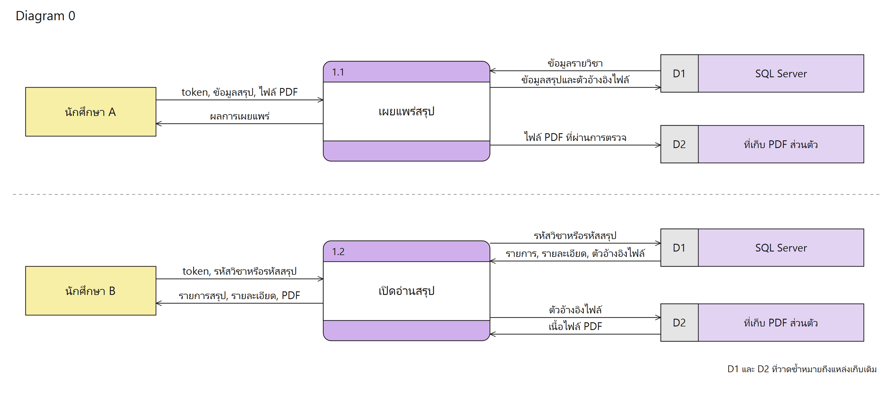

# U6 เผยแพร่สรุป PDF รายวิชา CS ให้ผู้ใช้อื่นเปิดอ่าน

## User Story Detail

**As a** นักศึกษามหาวิทยาลัยธรรมศาสตร์ที่ต้องการแบ่งปันสรุปการเรียนรายวิชา CS

**I want to** เลือกรายวิชา กรอกชื่อสรุป และอัปโหลดไฟล์ PDF พร้อมข้อมูลประกอบตามต้องการ แล้วเผยแพร่ให้ผู้ใช้อื่นเปิดอ่านไฟล์นั้นจากหน้ารายวิชาได้

**So that** นักศึกษาที่กำลังเตรียมสอบสามารถเข้าถึงและใช้สรุปที่ฉันแบ่งปันเพื่อทบทวนเนื้อหาของวิชานั้นได้
Priority: Medium

**Estimate:** 5 SP

## ระบบนี้ช่วยอะไร

นักศึกษาที่มีสรุปของวิชา CS สามารถเอา PDF มาลงไว้ในหน้าวิชานั้นได้ เช่น A ลงสรุป CS261 แล้ว B ที่ล็อกอินอยู่เปิดหน้าวิชา CS261 เลือกสรุปของ A และอ่านไฟล์ได้เลย

## UML Sequence Diagram

อ่านจากบนลงล่าง เส้นทึบคือการส่งคำขอ เส้นประคือผลที่ส่งกลับ และแท่งบนเส้นประแนวตั้งบอกว่าฝั่งนั้นกำลังทำงาน

**A เผยแพร่สรุป** หน้าเว็บส่งฟอร์มกับไฟล์ผ่าน `POST /api/summaries` Backend ใช้ token เช็กว่าใครล็อกอินอยู่ ตรวจวิชา และตรวจว่า PDF เปิดอ่านได้และไม่เกิน 15 MB พอบันทึกทั้งไฟล์และข้อมูลใน SQL Server ครบจึงตอบ HTTP status `201 Created` ให้หน้าเว็บขึ้นว่าเผยแพร่สำเร็จ

**B เปิดอ่านสรุป** หน้าเว็บขอรายการด้วยรหัสวิชา พอ B เลือกสรุป หน้าเว็บจะขอรายละเอียดด้วยรหัสสรุป แล้วใช้ `file.read_path` ที่ API ส่งกลับเพื่อขอไฟล์ PDF ทั้งสามคำขอต้องส่ง token และ API ตอบ HTTP status `200 OK` เมื่อส่งข้อมูลหรือไฟล์กลับได้สำเร็จ

## Dataflow Diagram

ลูกศรในภาพนี้บอกว่าแต่ละส่วนส่งข้อมูลอะไรให้กัน ในช่อง **1.1 เผยแพร่สรุป** ฟอร์มกับไฟล์ของ A เข้าระบบ ข้อมูลสรุปและตัวอ้างอิงไฟล์ไปที่ D1 ส่วนเนื้อไฟล์ PDF ไปที่ D2

ในช่อง **1.2 เปิดอ่านสรุป** ระบบใช้รหัสวิชาหรือรหัสสรุปไปดึงข้อมูลจาก D1 ถ้า B ขอเปิดไฟล์ ระบบใช้ตัวอ้างอิงจาก D1 ไปหยิบ PDF ใน D2 แล้วส่งไฟล์กลับให้ B กล่อง D1 และ D2 ที่เห็นซ้ำในภาพหมายถึงที่เก็บข้อมูลชุดเดียวกัน

## Test Cases

| เคส | ลองทำ | ควรได้ |
| --- | --- | --- |
| U6-TC01 | A ลง PDF ใน CS261 แล้วให้ B เปิดอ่านหลังโหลดหน้าใหม่ | สรุปยังอยู่ใน CS261 และ B อ่านไฟล์ตรงกับรายการ |
| U6-TC02 | เว้นช่องข้อมูลประกอบ | เผยแพร่และเปิดอ่านได้ |
| U6-TC03 | เว้นวิชา ชื่อ หรือไฟล์ทีละช่อง รวมถึงชื่อที่มีแต่ช่องว่าง | แจ้งช่องที่ต้องแก้และไม่สร้างรายการ |
| U6-TC04 | แนบไฟล์ที่ไม่ใช่ PDF ไฟล์ที่เปลี่ยนนามสกุลเป็น PDF หรือ PDF เกิน 15 MB | แจ้งว่าไฟล์ไม่ผ่านและไม่เผยแพร่ |
| U6-TC05 | ส่งวิชาที่ไม่มีหรืออยู่นอก CS หรือส่งเจ้าของเป็นอีกบัญชี | Backend ปฏิเสธและไม่สร้างสรุปในชื่อคนอื่น |
| U6-TC06 | เปิดรายการ หน้ารายละเอียด หรือ PDF โดยไม่มี token หรือ token ใช้ไม่ได้ | ระบบปฏิเสธการเข้าถึงและขอให้ล็อกอิน |
| U6-TC07 | จำลองให้เขียนข้อมูลกับเขียนไฟล์ล้มเหลวแยกกันก่อนเผยแพร่สำเร็จ | ไม่มีข้อความสำเร็จและไม่มีรายการที่เผยแพร่ค้างไว้ |
| U6-TC08 | เปิด CS261 ที่มีสรุปและ CS104 ที่ยังไม่มี | แต่ละวิชาแสดงเฉพาะข้อมูลของตัวเอง วิชาที่ว่างแจ้งว่ายังไม่มีสรุป |

