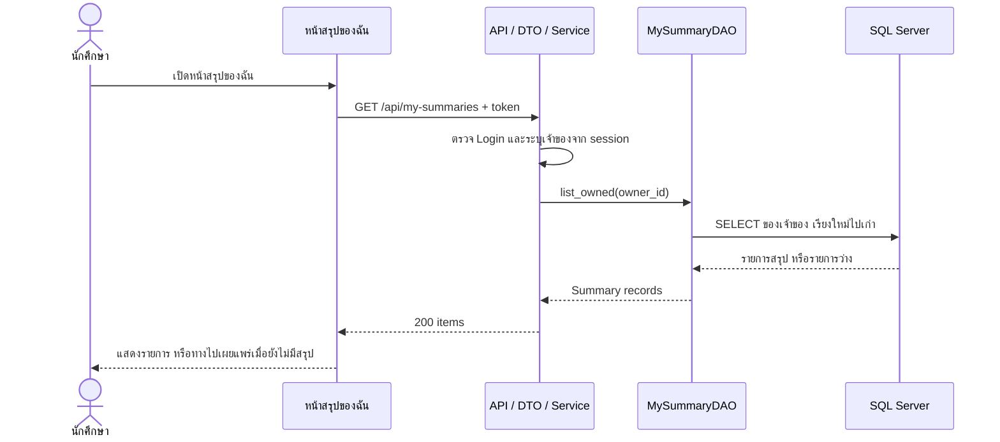
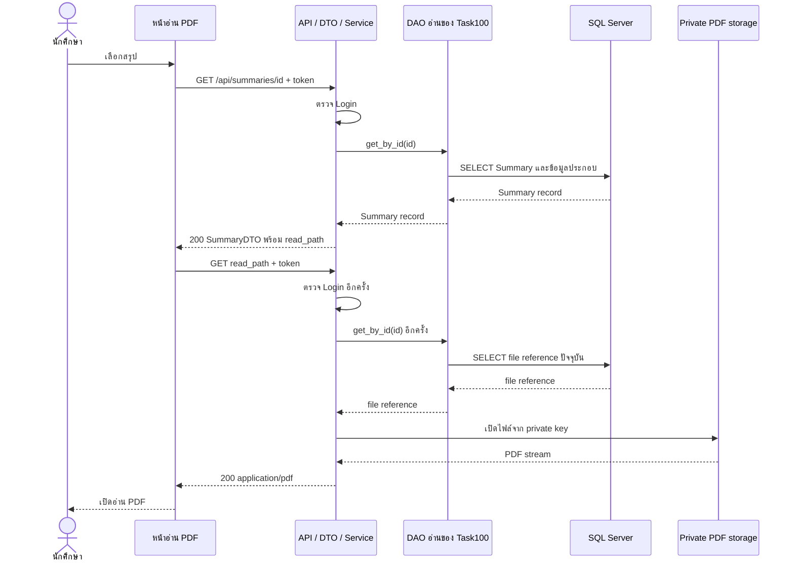
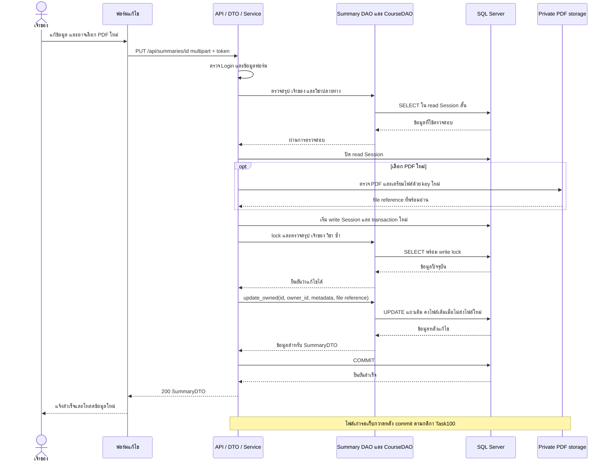
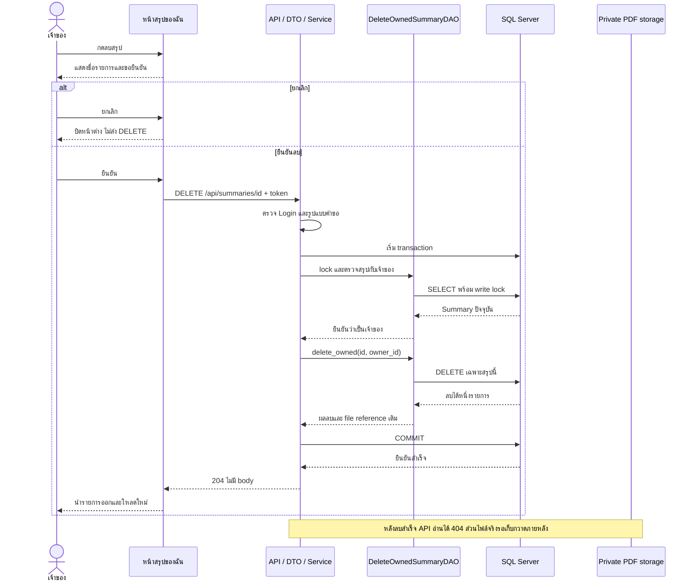

# Task101 U7 Sequence Diagram

รุ่น 0.2 | วันที่ 10 พฤศจิกายน 2569 | แบบเสนอสำหรับ review ยังไม่ใช่ flow ที่ implement แล้ว

แต่ละภาพแสดงเส้นทางสำเร็จเป็นหลัก รวม Router, DTO และ Service เป็นช่อง API เดียวเพื่อให้อ่านลำดับได้ง่าย DAO, SQL และ storage ยังแยกหน้าที่ชัดเจน กรณีผิดพลาดอยู่ในตารางใต้ภาพ เมื่อพบข้อผิดพลาดให้หยุดเส้นทางสำเร็จ ณ ขั้นที่เกี่ยวข้อง

อ่านคู่กับ [แบบ DAO และ transaction](task101-u7-dao-design.md) และ [แผนทดสอบกับ review](task101-u7-review-and-test-plan.md) ไฟล์ `.mmd` เป็นต้นฉบับแก้ไขได้และมีเนื้อหาตรงกับภาพในเอกสารนี้

## 1 ดูรายการสรุปของฉัน

[ต้นฉบับ Mermaid](diagrams/task101-my-list.mmd)

ภาพนี้อ่านเฉพาะ metadata จึงไม่เรียก storage และไม่มีการเขียนข้อมูล

| กรณี | ผลลัพธ์ |
| --- | --- |
| Login ใช้ไม่ได้ | 401 AUTH_REQUIRED ไม่ส่งข้อมูลรายการ |
| ส่ง query ที่ไม่ได้กำหนด เช่น user_id | 422 INVALID_PARAMETERS |
| ยังไม่มีสรุป | 200 items ว่าง พร้อมทางไปเผยแพร่ |
| อ่านฐานข้อมูลไม่ได้ | 503 STORAGE_UNAVAILABLE ไม่แสดงเป็นรายการว่าง |

## 2 เปิดอ่าน PDF

[ต้นฉบับ Mermaid](diagrams/task101-read.mmd)

ใช้ API อ่านร่วมของ Task100 การขอไฟล์ต้องตรวจ Login และอ่าน Summary ปัจจุบันซ้ำ แม้คำขอ metadata ก่อนหน้าจะสำเร็จ

| กรณี | ผลลัพธ์ |
| --- | --- |
| ไม่มี token หรือหมดอายุระหว่างคำขอ | 401 AUTH_REQUIRED ไม่ส่ง PDF |
| ID ผิดรูปแบบ | 422 INVALID_PARAMETERS |
| ไม่พบสรุป หรือถูกลบระหว่างโหลด metadata กับไฟล์ | 404 SUMMARY_NOT_FOUND |
| DB หรือ storage อ่านไม่ได้ก่อนส่ง PDF | 503 STORAGE_UNAVAILABLE |
| stream ขาดหลังเริ่มส่ง 200 แล้ว | เปลี่ยนเป็น JSON error ไม่ได้ UI แจ้งอ่านไม่สำเร็จและให้โหลดใหม่ |

UI fetch พร้อม Authorization ตรวจ status และ Content-Type ก่อนเปิด Blob URL ไม่ใส่ token ใน URL

## 3 แก้ไขและแทนที่ PDF

[ต้นฉบับ Mermaid](diagrams/task101-update.mmd)

PUT multipart เป็นข้อเสนอปรับ Task94/96 ตามมติล่าสุด เปลี่ยนวิชาและ PDF ได้ ถ้าไม่ส่งไฟล์ใหม่ให้คงไฟล์ปัจจุบันใต้ lock โดยคง ID เจ้าของและ created_at เสมอ

| กรณี | ผลลัพธ์ |
| --- | --- |
| Login ใช้ไม่ได้ | 401 AUTH_REQUIRED |
| พบสรุปแต่ไม่ใช่เจ้าของ | 403 SUMMARY_FORBIDDEN ไม่เตรียม PDF ใหม่ |
| ไม่พบ หรือถูกลบระหว่างเตรียมไฟล์ | 404 SUMMARY_NOT_FOUND ห้ามสร้างรายการกลับมา |
| วิชาปลายทางไม่มีหรือไม่ใช่ CS | 404 COURSE_NOT_FOUND |
| title ว่าง ข้อมูลผิด หรือส่งฟิลด์ต้องห้าม | 422 INVALID_PARAMETERS |
| PDF ผิดชนิด เปิดไม่ได้ หรือเกิน 15,000,000 bytes | 422 PDF_INVALID, 422 PDF_UNREADABLE หรือ 413 PDF_TOO_LARGE ตามเหตุ |
| storage หรือ DB ล้มเหลวและยืนยันว่าไม่ commit | 503 STORAGE_UNAVAILABLE rollback และคงข้อมูลกับ PDF เดิม |
| ผล commit ไม่แน่ชัด หรือ response ขาดหาย | เก็บไฟล์ทั้งสองไว้ ตรวจสถานะใหม่ ห้าม retry อัตโนมัติ |

read Session ของขั้นตรวจเบื้องต้นต้องปิดทุกเส้นทางก่อนเตรียมไฟล์ แล้วเปิด write Session ใหม่เพื่อ lock และตรวจซ้ำ รายละเอียด SQL, rowcount, DTO ก่อน commit และ cleanup อยู่ในแบบ DAO ส่วน 4 และ 5

## 4 ยืนยันและยกเลิกลบ

[ต้นฉบับ Mermaid](diagrams/task101-delete.mmd)

ยกเลิกไม่ส่ง API เมื่อยืนยันลบให้ตอบ 204 หลัง DB commit สำเร็จ ทุกคำขออ่านใหม่ต้องได้ 404 แม้ไฟล์ private ยังรอเก็บกวาด

| กรณี | ผลลัพธ์ |
| --- | --- |
| Login ใช้ไม่ได้ หรือรูปแบบคำขอผิด | 401 AUTH_REQUIRED หรือ 422 INVALID_PARAMETERS |
| พบสรุปแต่ไม่ใช่เจ้าของ | 403 SUMMARY_FORBIDDEN |
| ไม่พบหรือส่ง DELETE ซ้ำหลังลบแล้ว | 404 SUMMARY_NOT_FOUND |
| DB ล้มเหลวและยืนยัน rollback | 503 STORAGE_UNAVAILABLE สรุปและ PDF เดิมยังใช้ได้ |
| commit หรือ response มีผลไม่แน่ชัด | GET สถานะใหม่ก่อนตัดสินใจลบซ้ำ ไม่แจ้งสำเร็จโดยเดา |
| cleanup ไฟล์ล้มเหลวหลัง DB commit | คงผลลบสำเร็จและ retry cleanup ไม่สร้างสรุปกลับมา |

ไม่ลบ Course, User หรือผลงานอื่น รายละเอียด dependent records และ collector ใช้กติกาในแบบ DAO ส่วน 4 ถึง 6
