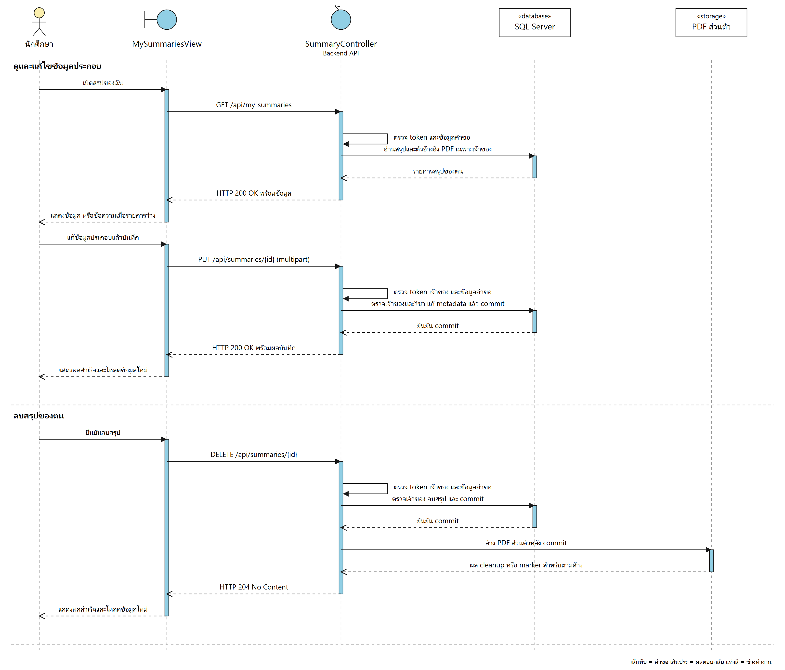
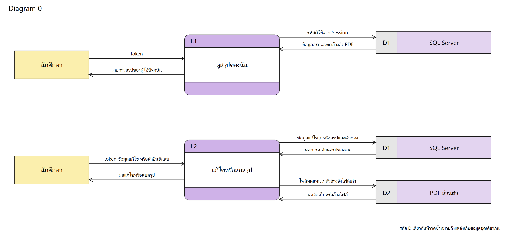

# U7 จัดการสรุป PDF ของตน

แผนภาพสำหรับอธิบายการทำงานของระบบ ใช้สีและสัญลักษณ์ตามชุด U6

## ระบบนี้ช่วยอะไร

จัดการสรุป PDF ของตน ผ่านหน้าเว็บที่เชื่อมกับ Backend และข้อมูลของระบบ

## UML Sequence Diagram

อ่านจากบนลงล่าง เส้นทึบคือคำขอ เส้นประคือผลตอบกลับ แท่งสีแสดงช่วงทำงาน ชื่อ View รวมหน้าเว็บและ JavaScript ส่วน Controller รวม Router, Service และ DAO; คำขอผ่าน Node proxy แต่ไม่แยกเป็น lifeline ภาพเน้นเส้นทางสำเร็จ รายละเอียด error อยู่ในเอกสารออกแบบเดิม

ภาพหลักแสดงการแก้ metadata โดยไม่เปลี่ยนไฟล์ จึงคง ID/เจ้าของ/PDF เดิม ใช้ API เปิดอ่านเดียวกับ U6 โค้ดรองรับการส่งไฟล์ทดแทนด้วย: ตรวจและเก็บไฟล์ใหม่ก่อนเปลี่ยนตัวอ้างอิงใน transaction แล้วจึงล้างไฟล์เก่า การลบ commit metadata ก่อนล้าง PDF ส่วนตัว; ถ้าล้างไฟล์ไม่สำเร็จมี reconciliation marker สำหรับตามล้าง ไม่ใช่การ rollback ทุกขั้นพร้อมกัน

## Dataflow Diagram

กล่องสีเหลืองคือนักศึกษาหรือระบบภายนอก กล่อง process สีม่วงแสดงงาน ลูกศรระบุข้อมูลที่ส่งระหว่างกัน รหัส D เดียวกันที่วาดซ้ำหมายถึงแหล่งข้อมูลชุดเดียวกัน การตรวจ token อยู่ที่ขอบเขต Backend ตาม U1 ไม่ได้วาดซ้ำทุก process

**1.1 ดูสรุปของฉัน** รับ token แล้วส่งกลับ รายการสรุปของผู้ใช้ปัจจุบัน โดยอ่านหรือเปลี่ยนข้อมูลตามลูกศรในภาพ

**1.2 แก้ไขหรือลบสรุป** รับ token ข้อมูลแก้ไข หรือคำยืนยันลบ แล้วส่งกลับ ผลแก้ไขหรือลบสรุป โดยอ่านหรือเปลี่ยนข้อมูลตามลูกศรในภาพ

## ไฟล์อ้างอิง

- [my_summaries.py](../../../backend/app/routers/my_summaries.py)
- [my_summaries.py](../../../backend/app/services/my_summaries.py)
- [task101-u7-sequences.md](task101-u7-sequences.md)
- [SVG Sequence ที่แก้ไขได้](diagrams/u7-sequence.svg)
- [SVG Dataflow ที่แก้ไขได้](diagrams/u7-dataflow.svg)
