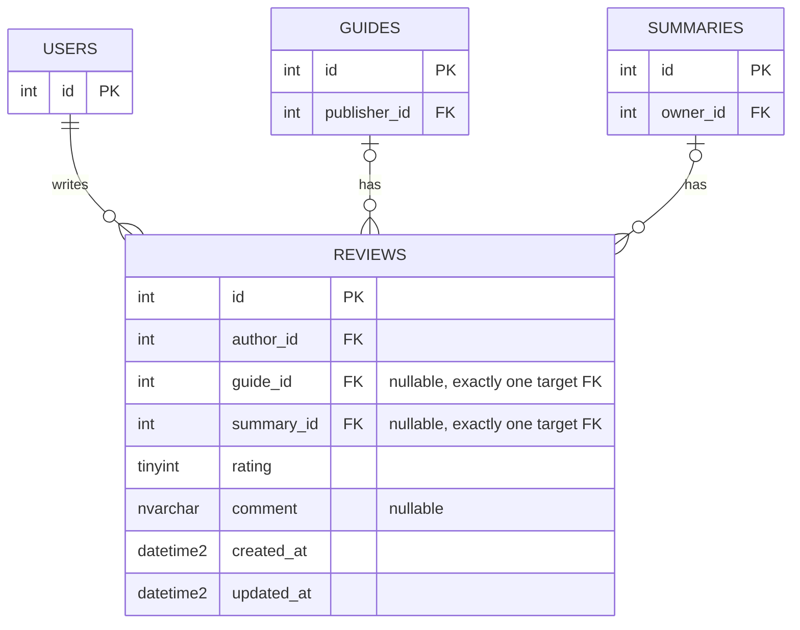
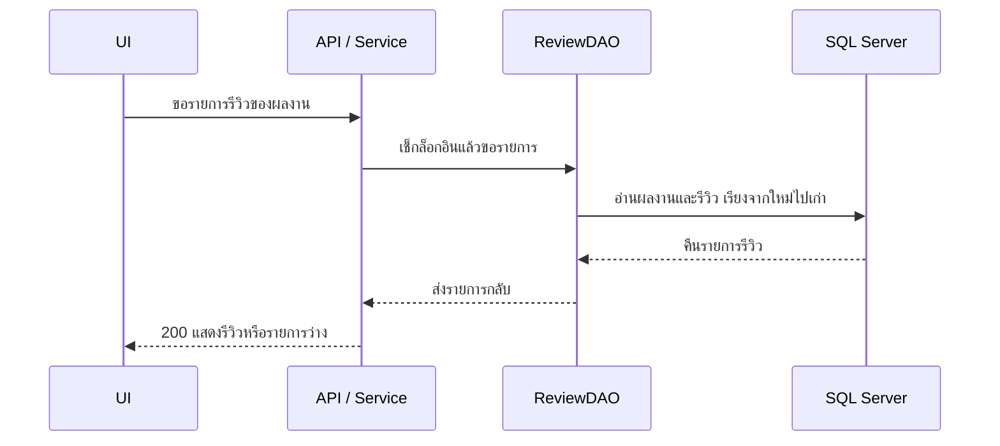
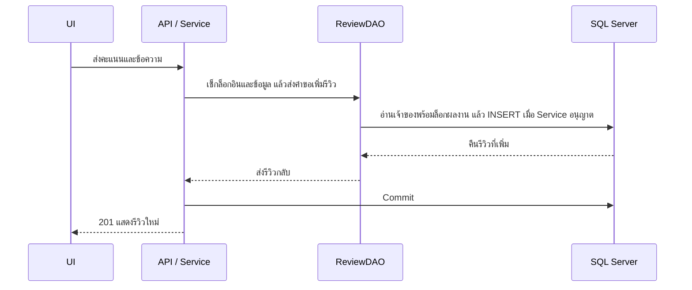
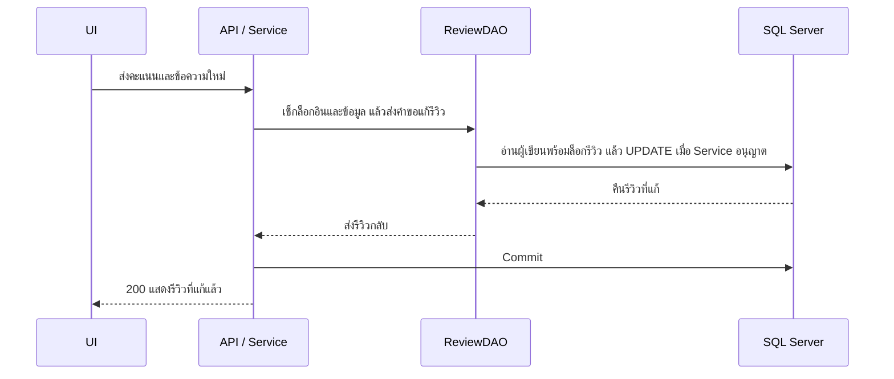
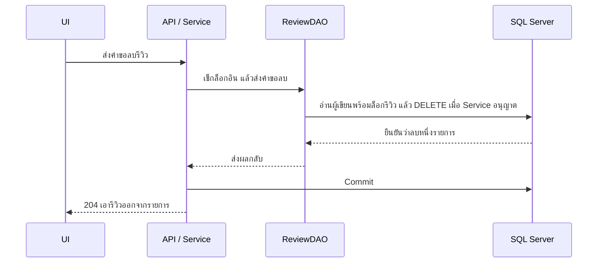

# Task102 ออกแบบ Backend รีวิวของ U8

รุ่น 0.1 · 14 พฤศจิกายน 2569 · รอทีมตรวจแบบ

## กติกาที่ใช้ร่างแบบ

- รีวิวผูกกับแนวข้อสอบหรือสรุป PDF ทีละชิ้น ทุก API ต้องล็อกอิน แก้หรือลบรีวิวได้เฉพาะคนที่เขียนรีวิวนั้น
- คะแนนเป็นจำนวนเต็ม 1 ถึง 5 ข้อความจะใส่หรือเว้นไว้ก็ได้ แบบนี้ใช้กติกาใน Task94 v0.2 ให้ trim ก่อนนับ จำกัด 2,000 Unicode code points และเก็บเป็น `NULL` เมื่อเว้นว่างหรือมีแต่ whitespace
- แบบใช้ข้อเสนอใน Task94 ว่าห้ามรีวิวผลงานตัวเอง หนึ่งคนมีหนึ่งรีวิวต่อผลงาน และลบแล้วรีวิวใหม่ได้ ส่วนการเคยเปิดอ่านยังเป็นบริบทของ Story ไม่มีตารางเก็บประวัติการอ่าน
- Task94 และ Task97 ใน GitHub ยังรอ review ให้ยืนยัน TC07–TC08, ขีดจำกัดข้อความ, การล้างข้อความเมื่อไม่ส่งใน PUT และกติกาลบแล้วเพิ่มใหม่กับทีมก่อนใช้ตรวจรับ Trello มีไฟล์ Task97 ชื่อ PO Reviewed แต่ยังไม่ได้ตรวจเนื้อหาไฟล์นั้น จึงใช้ Task97 ใน GitHub เป็นหลักสำหรับร่างนี้
- ใช้ `guides.publisher_id` จาก `sprint2` และ `summaries.owner_id` จาก snapshot U6 PR #108 สำหรับเช็กเจ้าของผลงาน ตอน Integration ให้เทียบชื่อและข้อจำกัดกับ model U6 ที่ใช้จริงอีกครั้ง

[Story U8](https://trello.com/c/LpM7q0ya) · [Task94 v0.2](https://github.com/Lilieay/cs261-group4-100001/blob/de3e669/docs/task94-api-contract.md) · [Task97 รุ่น 0.1](https://github.com/Lilieay/cs261-group4-100001/blob/96f4e2d/docs/U8/requirements/task97-u8-requirements-and-test-cases.md) · [U6 model snapshot](https://github.com/Lilieay/cs261-group4-100001/blob/922daff/backend/app/models/summary.py)

## ตาราง `reviews`

ใช้ตารางเดียวเพื่อให้ `review_id` ใช้กับ PUT และ DELETE ได้โดยตรง ให้ SQL Server ตรวจ FK ของผลงานทั้งสองชนิด และให้ API อ่าน `target_type` กับ `target_id` จาก FK ที่มีค่า

| ฟิลด์ | ค่าที่เก็บ |
|---|---|
| `id` | `INT IDENTITY` เป็น PK |
| `author_id` | `INT NOT NULL` FK ไป `users.id` ใช้ `NO ACTION` เมื่อมีรีวิวอ้างผู้ใช้ |
| `guide_id` | `INT NULL` FK ไป `guides.id` ใช้ `ON DELETE CASCADE` |
| `summary_id` | `INT NULL` FK ไป `summaries.id` ใช้ `ON DELETE CASCADE` |
| `rating` | `TINYINT NOT NULL` และ `CHECK (rating BETWEEN 1 AND 5)` |
| `comment` | `NVARCHAR(4000) NULL` เผื่อ 2 UTF-16 code units ต่อ Unicode code point ตรวจเพดาน 2,000 code points ที่ API |
| `created_at`, `updated_at` | `DATETIME2(3) NOT NULL` Backend ใช้ UTC และส่งออก RFC 3339 แบบ UTC |

ให้ `guide_id` หรือ `summary_id` มีค่าเพียงหนึ่งช่องด้วย CHECK ด้านล่าง ใช้ filtered unique index แยกตามชนิดผลงาน เพื่อให้รีวิวของคนเดียวกันใน Guide 101 และ Summary 101 อยู่ได้ทั้งคู่

```sql
CHECK ((guide_id IS NOT NULL AND summary_id IS NULL)
    OR (guide_id IS NULL AND summary_id IS NOT NULL))

CREATE UNIQUE INDEX ux_reviews_guide_author ON reviews(guide_id, author_id)
WHERE guide_id IS NOT NULL;

CREATE UNIQUE INDEX ux_reviews_summary_author ON reviews(summary_id, author_id)
WHERE summary_id IS NOT NULL;
```

เพิ่ม index สำหรับรายการตาม `(guide_id, created_at DESC, id DESC)` และ `(summary_id, created_at DESC, id DESC)` แบบ filter ตาม FK ที่มีค่า ก่อนเพิ่ม migration ให้ตรวจ cascade path บน SQL Server จริงกับ schema ของ U6/U7 และรันบนฐานข้อมูลที่มี Guide และ Summary อยู่แล้ว

### ความสัมพันธ์ของตาราง

[ไฟล์ Mermaid](diagrams/task102-review-er.mmd)




## DAO และ transaction

Service เปิด transaction และเป็นคน commit หรือ rollback ส่วน DAO ใช้ Session เดียวกัน ผลลัพธ์เป็น record ภายใน ส่วน DTO เปิดเฉพาะ `id`, `target_type`, `target_id`, `rating`, `comment`, `author: {id, display_name}`, `created_at` และ `updated_at`

| DAO | รับและคืนอะไร | กรณีที่ต้องจัดการ |
|---|---|---|
| `list_for_target(target_type, target_id)` | อ่านจากตารางผลงานเป็นหลักแล้ว LEFT JOIN รีวิวและผู้เขียนใน statement เดียว คืนรายการเรียง `created_at DESC, id DESC` | ถ้าไม่มีแถวผลงานคืนสถานะไม่พบ ถ้ามีผลงานแต่ review ID เป็น NULL คืนรายการว่าง |
| `get_target_for_create(target_type, target_id)` | อ่าน id และเจ้าของของ Guide หรือ Summary ด้วย SQL Server `UPDLOCK, HOLDLOCK` ให้ล็อกคงอยู่ถึงจบ transaction | คืนไม่พบเมื่อผลงานหาย Service ใช้ owner ที่อ่านได้เพื่อเช็กว่าผู้ใช้กำลังรีวิวงานตัวเองหรือไม่ |
| `create(target_type, target_id, author_id, rating, comment)` | ใส่ FK ของชนิดที่เลือก ตั้งเวลา สั่ง INSERT และ flush เพื่อได้ `review_id` | แปลงเฉพาะ duplicate ที่ตรงกับ unique index ของรีวิวเป็น 409 แล้ว rollback ข้อผิดพลาด SQL อื่นจัดการตามสาเหตุ |
| `get_review_for_write(review_id)` | อ่านแถวรีวิวด้วย `UPDLOCK, HOLDLOCK` และคืน `author_id` กับ FK ที่ใช้อยู่ | ไม่พบคืน 404 ถ้าพบแต่คนละผู้เขียนตอบ 403 หลังเช็กใน Service |
| `update_owned(review_id, author_id, rating, comment)` | UPDATE เฉพาะคะแนน ข้อความ และ `updated_at` โดยกรองทั้ง ID และผู้เขียน คืนแถวที่แก้ | ต้องแก้ได้หนึ่งแถว ถ้าไม่พบให้ rollback และตอบ 404 ไม่มี insert |
| `delete_owned(review_id, author_id)` | DELETE โดยกรองทั้ง ID และผู้เขียน คืนจำนวนแถว | สำเร็จเมื่อ commit แล้วและลบหนึ่งแถว เรียกซ้ำได้ 404 |

POST ล็อกแถวผลงานก่อน INSERT เพื่อให้การตรวจเจ้าของและการลบผลงานเกิดตามลำดับ ส่วน PUT และ DELETE ล็อกเฉพาะแถวรีวิวและใช้ FK ใน DTO ได้เลย ไม่ต้องล็อกผลงานย้อนกลับจากแถวรีวิว ใช้ unique index กันรีวิวซ้ำแม้ส่ง POST พร้อมกัน สร้าง DTO ก่อน commit และส่งผลสำเร็จเมื่อ commit ผ่านแล้ว

เมื่อลบ Guide หรือ Summary ให้ SQL ลบรีวิวที่อ้าง FK ของผลงานชิ้นนั้นใน transaction เดียวกัน โดยไม่กระทบผลงานอีกชนิดที่มี ID เท่ากัน ถ้าการลบผลงาน rollback รีวิวต้องกลับมาด้วย U8 เก็บข้อมูลใน SQL เท่านั้น การลบไฟล์จริงเป็นหน้าที่ของ flow ลบ Summary ใน U7

## เส้นทางและผลตอบกลับ

| คำขอ | ผลสำเร็จ | เมื่อไม่พบหรือไม่มีสิทธิ์ |
|---|---|---|
| `GET /api/guides/{guide_id}/reviews` หรือ `GET /api/summaries/{summary_id}/reviews` | 200 `{target_type, target_id, items}` | 404 `GUIDE_NOT_FOUND` หรือ `SUMMARY_NOT_FOUND` |
| POST ที่ path เดียวกับ GET | 201 พร้อม ReviewDTO | 404 เมื่อผลงานหาย, 403 `SELF_REVIEW_FORBIDDEN`, 409 `REVIEW_ALREADY_EXISTS` |
| `PUT /api/reviews/{review_id}` | 200 พร้อม ReviewDTO ของ ID เดิม | 404 `REVIEW_NOT_FOUND` หรือ 403 `REVIEW_FORBIDDEN` |
| `DELETE /api/reviews/{review_id}` | 204 ไม่มี body | 404 `REVIEW_NOT_FOUND` หรือ 403 `REVIEW_FORBIDDEN` |

ใช้ Bearer session ระบุผู้ใช้ก่อนอ่านหรือแก้ข้อมูล ถ้า token ใช้ไม่ได้ตอบ 401 `AUTH_REQUIRED` พร้อม `WWW-Authenticate: Bearer` ทุก response ใช้ `Cache-Control: no-store`

POST และ PUT รับ JSON เฉพาะ `rating` กับ `comment` ปฏิเสธคะแนนชนิด string, boolean หรือทศนิยม และฟิลด์อย่าง `author_id` หรือ `target_id` ด้วย 422 `INVALID_PARAMETERS` ID ใน path ใช้เลขฐานสิบจำนวนเต็มบวกไม่เกิน 2,147,483,647 PUT ต้องส่งคะแนนทุกครั้ง และการไม่ส่งข้อความหมายถึงล้างค่าเดิม GET และ DELETE ไม่มี body ทุกเส้นทางปฏิเสธ query parameter ที่ไม่ได้กำหนด

ใช้ error envelope ของ Task94 ส่ง JSON ผิดรูปแบบตอบ 400 `MALFORMED_REQUEST` และชนิด request ผิดตอบ 415 `UNSUPPORTED_MEDIA_TYPE` เมื่อ SQL ล้มเหลวก่อน commit และยืนยัน rollback ได้ ให้ตอบ 503 `STORAGE_UNAVAILABLE` โดยคงข้อมูลเดิม ถ้าการเชื่อมต่อหลุดจนไม่ทราบผล commit ให้ตอบ 503 เมื่อยังส่ง response ได้ และให้ UI โหลดรายการล่าสุดก่อนแจ้งผลหรือให้ผู้ใช้ลองใหม่ โดยเฉพาะ POST ที่ห้าม retry อัตโนมัติ

### ### แผนภาพลำดับ

ทั้งสี่ภาพใช้กับแนวข้อสอบและสรุป PDF เหมือนกัน ภาพแสดงทางเดินตอนทำสำเร็จ ผลตอบกลับเมื่อข้อมูลผิดหรือ SQL ล้มเหลวดูได้จากตารางด้านบน

#### แสดงรายการ

[ไฟล์ Mermaid](diagrams/task102-review-list.mmd)



ผลงานไม่มีหรือถูกลบได้ 404 ตามชนิด ส่วนผลงานที่ยังอยู่แต่ไม่มีรีวิวได้ 200 พร้อม `items: []`

#### เพิ่มรีวิว

[ไฟล์ Mermaid](diagrams/task102-review-create.mmd)



ถ้าเป็นผลงานตัวเองตอบ 403 ถ้ารีวิวซ้ำตอบ 409 และให้แก้รายการเดิม

#### แก้ไขรีวิว

[ไฟล์ Mermaid](diagrams/task102-review-update.mmd)



ถ้าเป็นรีวิวของคนอื่นตอบ 403 ถ้ารีวิวหายตอบ 404 แก้สำเร็จต้องได้ ID เดิม

#### ลบรีวิว

[ไฟล์ Mermaid](diagrams/task102-review-delete.mmd)



ถ้าเป็นรีวิวของคนอื่นตอบ 403 ถ้ารีวิวหายตอบ 404 ลบสำเร็จแล้วรีวิวคนอื่นยังอยู่

แผนทดสอบ

ใช้ Guide 101 และ Summary 101 เป็นคนละผลงาน มีเจ้าของ P ผู้รีวิว R และผู้ใช้อื่น X ใช้คะแนนกับข้อความตาม fixture ของ Task94 และรันกรณีที่เกี่ยวข้องแยกทั้งสองชนิด

| ระดับ | สิ่งที่จะตรวจ |
|---|---|
| Unit | TC02–TC03 คะแนน 1 และ 5 ผ่าน ค่าขาดหาย 0, 6, ติดลบ, ทศนิยม, string และ boolean ไม่ผ่าน ตรวจ trim, null และขอบเขตข้อความ 2,000/2,001 ตัวอักษร |
| API | TC01–TC02 เพิ่มแล้วโหลดใหม่ และเพิ่มแบบไม่มีข้อความ TC04 แก้ ID เดิมพร้อมล้างข้อความ TC05 ลบเฉพาะของตัวเองและคืน 204 ไม่มี body |
| API | TC03 และ TC06 ตรวจข้อมูลผิดบน POST/PUT, ฟิลด์ปลอม, ไม่มี token หรือ token หมดอายุ และ X แก้หรือลบรีวิวของ R ไม่ได้ TC07 ห้าม P รีวิวงานตัวเองตามข้อเสนอ TC08 คำขอซ้ำได้ 409 และ Guide/Summary เลขเดียวกันแยกกันได้ |
| API | TC09 ตรวจ GET/POST ของผลงานที่หาย และ PUT/DELETE ของรีวิวที่หายตามรหัส error จำลอง DB ล้มเหลวก่อน commit สำหรับ POST/PUT/DELETE และตรวจว่าข้อมูลเดิมกับรีวิวอื่นยังอยู่ |
| SQL Server / Integration | ตรวจ FK, CHECK, filtered unique index และ cascade จริง ให้ R ส่ง POST สองคำขอพร้อมกันแล้วได้หนึ่ง 201 กับหนึ่ง 409 ทดสอบลบผลงานชนกับการเพิ่มหรือแก้รีวิว ลบสำเร็จแล้ว GET/POST และ PUT/DELETE ต้องได้ 404 ตามชนิด และ Guide/Summary ที่ ID เท่ากันอีกฝั่งต้องยังอยู่ |
| SQL Server / Integration | ทดสอบ rollback ของการลบผลงานว่าคืนรีวิวด้วย และตรวจว่าการลบรีวิวของ Summary ไม่เปลี่ยน metadata หรือ bytes ของ PDF ทดสอบกรณี response หายหลัง commit แล้ว UI โหลดผลใหม่ |

## บันทึกตรวจแบบ

- 14 พ.ย. 2569 ตรวจชื่อคีย์ของ Guide จาก `sprint2` และ Summary จาก U6 snapshot แล้ว เทียบ API/DTO กับ Task94 v0.2 และจับคู่ TC01–TC09 กับแผนทดสอบแล้ว
- รอทีมและ PO ยืนยันกติกาที่ระบุข้างต้น รวมถึงตรวจ migration และลำดับ lock ด้วย SQL Server ในงานถัดไป รอบนี้เป็นงานแบบ จึงยังไม่มีผล Unit/API/Integration ของระบบจริง
