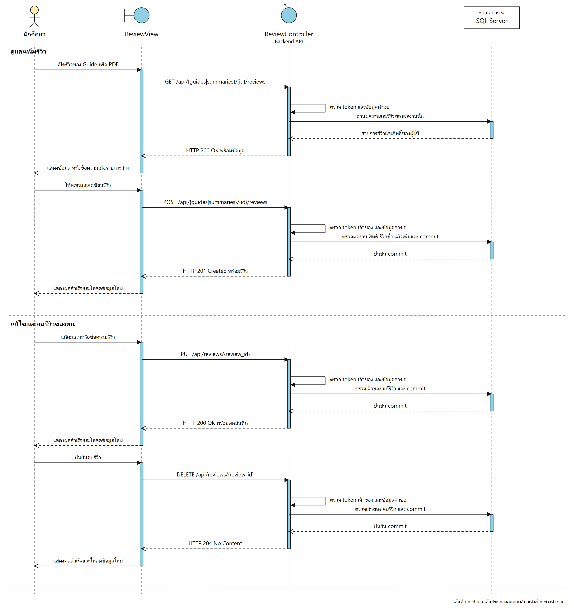
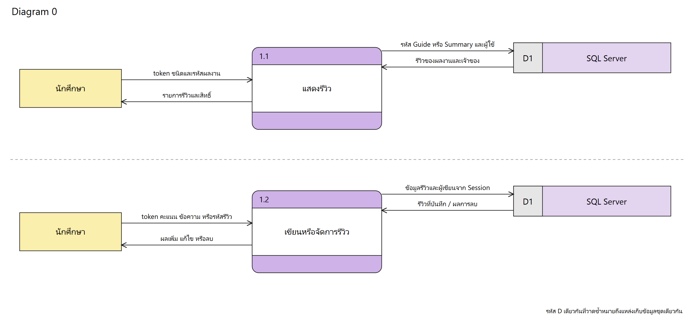

# U8 แสดง เพิ่ม แก้ไข และลบรีวิว

แผนภาพสำหรับอธิบายการทำงานของระบบ ใช้สีและสัญลักษณ์ตามชุด U6

## ระบบนี้ช่วยอะไร

แสดง เพิ่ม แก้ไข และลบรีวิว ผ่านหน้าเว็บที่เชื่อมกับ Backend และข้อมูลของระบบ

## UML Sequence Diagram

อ่านจากบนลงล่าง เส้นทึบคือคำขอ เส้นประคือผลตอบกลับ แท่งสีแสดงช่วงทำงาน ชื่อ View รวมหน้าเว็บและ JavaScript ส่วน Controller รวม Router, Service และ DAO; คำขอผ่าน Node proxy แต่ไม่แยกเป็น lifeline ภาพเน้นเส้นทางสำเร็จ รายละเอียด error อยู่ในเอกสารออกแบบเดิม

guides|summaries เป็นสัญลักษณ์เลือกชนิด ไม่ใช่ URL ที่ส่งจริง ตรวจ token ทุกคำขอ คะแนน 1–5 ข้อความตามข้อกำหนด ผู้ใช้แก้/ลบได้เฉพาะรีวิวของตน ห้ามรีวิวผลงานตนเองและห้ามเพิ่มซ้ำในผลงานเดียวกัน ความล้มเหลวไม่แสดงผลสำเร็จแทน

## Dataflow Diagram

กล่องสีเหลืองคือนักศึกษาหรือระบบภายนอก กล่อง process สีม่วงแสดงงาน ลูกศรระบุข้อมูลที่ส่งระหว่างกัน รหัส D เดียวกันที่วาดซ้ำหมายถึงแหล่งข้อมูลชุดเดียวกัน การตรวจ token อยู่ที่ขอบเขต Backend ตาม U1 ไม่ได้วาดซ้ำทุก process

**1.1 แสดงรีวิว** รับ token ชนิดและรหัสผลงาน แล้วส่งกลับ รายการรีวิวและสิทธิ์ โดยอ่านหรือเปลี่ยนข้อมูลตามลูกศรในภาพ

**1.2 เขียนหรือจัดการรีวิว** รับ token คะแนน ข้อความ หรือรหัสรีวิว แล้วส่งกลับ ผลเพิ่ม แก้ไข หรือลบ โดยอ่านหรือเปลี่ยนข้อมูลตามลูกศรในภาพ

## ไฟล์อ้างอิง

- [reviews.py](../../../backend/app/routers/reviews.py)
- [reviews.py](../../../backend/app/services/reviews.py)
- [task102-u8-review-backend-design.md](task102-u8-review-backend-design.md)
- [SVG Sequence ที่แก้ไขได้](diagrams/u8-sequence.svg)
- [SVG Dataflow ที่แก้ไขได้](diagrams/u8-dataflow.svg)
