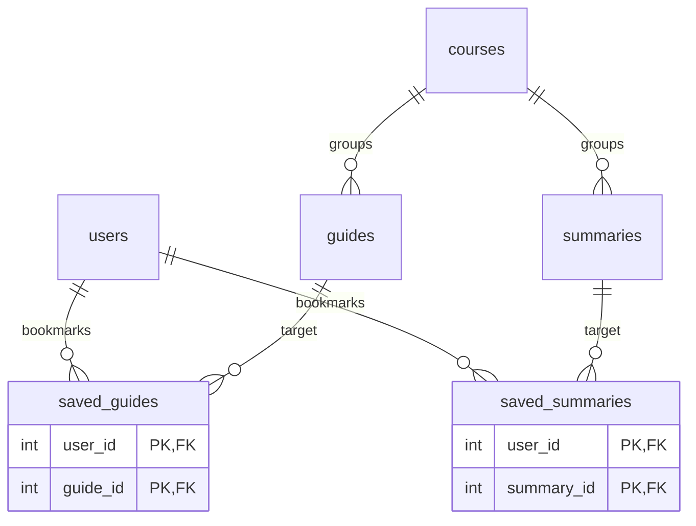
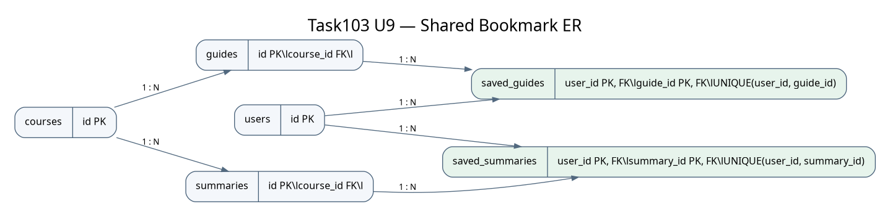

# Task103 U9 — DAO และ API Design

**รุ่น 0.4 | วันที่ 15 พฤศจิกายน 2569 | สถานะ: Draft for Review**

เอกสารฉบับนี้ปรับจาก Task103 v0.1 ให้สอดคล้องกับ **Task94 API Contract v0.4** และแนวทางข้อมูล/DAO ใน **Task104 U10 v0.3** โดยบันทึกผลงานทีละชิ้น ได้แก่ Guide (`guide`) และ Summary PDF (`summary`) ไม่ใช่ Course ทั้งวิชา

> สถานะ: เป็นแบบออกแบบเพื่อส่ง Frontend / Backend / PO ตรวจ ยังไม่ใช่หลักฐานว่า implementation หรือ test ผ่านแล้ว

## 1. ข้อสรุปที่ใช้ร่วมกัน

1. U9 และ U10 ใช้ bookmark data ชุดเดียวกัน: `saved_guides` สำหรับ Guide และ `saved_summaries` สำหรับ Summary
2. U9 PUT และ U10 GET/DELETE ต้องอ่านหรือเปลี่ยน relation เดียวกัน ไม่มีตาราง `saved_items` กลางแบบ polymorphic
3. `saved_guides` เดิมคงไว้ ไม่ migrate, copy, rename หรือแปลงข้อมูลอัตโนมัติ ส่วนรายการ Guide ใหม่ต้องเขียนลง `saved_guides` เดิม จึงอ่านร่วมกับรายการเดิมได้โดยไม่สร้าง relation ซ้ำ
4. `saved_summaries` เป็น relation สำหรับ Summary โดยใช้ FK ไป `summaries.id` และ composite primary key `(user_id, summary_id)`
5. API state ใช้ `SavedItemState = {item_type, item_id, saved}` ตาม Task94 v0.4
6. PUT ครั้งแรกและ PUT ซ้ำตอบ `200` พร้อม body รูปแบบเดียวกัน `{item_type, item_id, saved: true}` ไม่มี `already_saved` หรือข้อความ duplicate ใน response
7. UI แสดงข้อความ “ได้บันทึกการแบ่งปันนี้ไปแล้ว” จากสถานะ `saved` ที่ UI ทราบอยู่ก่อนส่ง PUT ไม่ใช่จาก response คนละแบบ
8. DB read/write/commit failure ของ saved-items ตอบ `503 SAVED_ITEMS_UNAVAILABLE` ห้ามแปลงเป็น `saved:false` หรือ success
9. ใน save flow ต้องเริ่ม transaction ก่อน target SELECT เพื่อป้องกัน SQLAlchemy Session autobegin ทำให้ `BEGIN` ซ้ำหรือเริ่ม transaction ไม่ถูกลำดับ

## 2. ขอบเขตและ dependency

| แหล่ง | ใช้เป็นฐาน |
|---|---|
| Task94 API Contract v0.4 (14 พ.ย. 2569) | Endpoint, DTO, validation, status/error และ idempotent PUT |
| Task104 U10 DAO/Sequence v0.3 | แยก relation ตามชนิด, FK, composite key, shared storage กับ U10 |
| Task98 U9 Requirements & Test Cases | ยึด requirement บันทึก Guide/Summary รายชิ้นและชุด TC; รายละเอียด TC06–TC12 ต้องเทียบต้นฉบับ Task98 ก่อนปิด review |
| Task103 v0.1 | นำเนื้อหา DAO/sequence เดิมมาปรับ ไม่ถือข้อเสนอเดิมที่ขัด Contract เป็นข้อสรุป |

ไม่สร้างตาราง `users`, `courses`, `guides`, `summaries` ซ้ำ และไม่ใช้ polymorphic FK เพราะ `item_id` เดียวไม่สามารถ FK ไปยังสอง target tables ได้อย่างปลอดภัย

## 3. ER และความสัมพันธ์





**คีย์และ FK ที่ต้องมี**

| Relation | Primary key / uniqueness | Foreign keys |
|---|---|---|
| `saved_guides` (เดิม) | `(user_id, guide_id)` | `user_id → users.id`, `guide_id → guides.id` |
| `saved_summaries` (เพิ่มตาม data-model approval) | `(user_id, summary_id)` | `user_id → users.id`, `summary_id → summaries.id` |

Composite primary key ทำหน้าที่กัน bookmark ซ้ำต่อผู้ใช้และ target เดียวกัน Guide 101 กับ Summary 101 อยู่ร่วมกันได้เพราะเป็นคนละ relation table ไม่ใช่การชนกันของ ID

**การอยู่ร่วมกับข้อมูลเดิม:** ห้าม migrate `saved_guides` เดิมอัตโนมัติ ให้ตรวจว่า existing table มี key/FK ตามที่ระบุหรือไม่ หาก constraint จริงต่างจากนี้ให้ data-model owner ทำ migration plan แยกก่อน merge แบบนี้ การเขียน Guide ใหม่ต้อง insert ลง `saved_guides` เดิม ทำให้ U10 list เห็นรายการใหม่และรายการเดิมใน relation เดียวกัน ส่วน Summary ใหม่ลง `saved_summaries`

`ON DELETE CASCADE` จาก target หรือ user เป็นข้อเสนอด้าน referential cleanup ให้เจ้าของ Task100/data model ยืนยันตาม deletion policy ก่อน DDL จริง

## 4. API และ DTO ตาม Task94 v0.4

ทุก endpoint ใช้ `Authorization: Bearer <access_token>`, `Cache-Control: no-store`, ไม่มี request body และไม่มี query parameter ที่ไม่ได้ระบุ เจ้าของมาจาก authenticated session เท่านั้น

| Method | Path | Success |
|---|---|---|
| GET | `/api/saved-items` | `200 SavedItemListResponse` |
| PUT | `/api/saved-items/{item_type}/{item_id}` | `200 SavedItemState` |
| GET | `/api/saved-items/{item_type}/{item_id}` | `200 SavedItemState` |
| DELETE | `/api/saved-items/{item_type}/{item_id}` | `200 SavedItemState` |

`item_type` รับเฉพาะ `guide` หรือ `summary`; `item_id` เป็น path integer บวก 1 ถึง 2,147,483,647

### SavedItemState

```json
{
  "item_type": "guide",
  "item_id": 101,
  "saved": true
}
```

**PUT ครั้งแรกและ PUT ซ้ำต้องคืน response เดียวกัน**

```http
HTTP/1.1 200 OK
Cache-Control: no-store
Content-Type: application/json
```
```json
{"item_type":"guide","item_id":101,"saved":true}
```

ห้ามเพิ่ม `already_saved`, `message` หรือ status code แยกสำหรับ duplicate เพราะไม่อยู่ใน Task94 v0.4

### SavedItemListResponse

```json
{
  "items": [
    {
      "item_type": "guide",
      "item_id": 101,
      "course": {"id": 7, "course_code": "CS261", "course_name": "INTRODUCTION TO SOFTWARE ENGINEERING"},
      "title": "แนวข้อสอบกลางภาค",
      "open_path": "/api/guides/101"
    }
  ]
}
```

Summary ใช้ `item_type: "summary"` และ `open_path: "/api/summaries/{item_id}"`; เมื่อเปิดรายละเอียดให้ใช้ `file.read_path` เช่น `/api/summaries/101/file` ตาม Task94 U6 โดยส่ง Bearer token ผ่าน fetch ไม่ใส่ token ใน URL

ลำดับรายการ: `course.course_code ASC`, `item_type ASC`, `item_id DESC`; UI group ด้วย `course.id` แต่แต่ละผลงานยังเป็นคนละรายการ

## 5. DAO / Service design

DAO ใช้ SQLAlchemy Session ที่ Service ส่งให้ ไม่ commit/rollback เอง ไม่สร้าง HTTP response และไม่รับ `user_id` จาก request body; Service เป็นเจ้าของ transaction boundary และการจำแนก/แปลง domain errors เป็นผลลัพธ์ตาม Contract

| Method | หน้าที่ | Contract |
|---|---|---|
| `SavedGuideDAO.target_exists(session, guide_id)` | ตรวจ Guide ใน `guides` | คืน target/None; DB error propagate |
| `SavedSummaryDAO.target_exists(session, summary_id)` | ตรวจ Summary ใน `summaries` | คืน target/None; DB error propagate |
| `SavedGuideDAO.is_saved(session, user_id, guide_id)` | อ่าน `saved_guides` | bool; DB error propagate |
| `SavedSummaryDAO.is_saved(session, user_id, summary_id)` | อ่าน `saved_summaries` | bool; DB error propagate |
| `SavedGuideDAO.insert_if_absent(session, user_id, guide_id)` | insert bookmark Guide | ใช้ PK/unique `(user_id, guide_id)` เป็น final guard |
| `SavedSummaryDAO.insert_if_absent(session, user_id, summary_id)` | insert bookmark Summary | ใช้ PK/unique `(user_id, summary_id)` เป็น final guard |
| `SavedGuideDAO.list_by_user(session, user_id)` | list Guide + Course | filter owner; DB error ไม่คืน `[]` |
| `SavedSummaryDAO.list_by_user(session, user_id)` | list Summary + Course + file metadata | ไม่อ่าน PDF bytes; DB error ไม่คืน `[]` |
| `SavedGuideDAO.remove(session, user_id, guide_id)` | ลบ relation เท่านั้น | rowcount 0/1 |
| `SavedSummaryDAO.remove(session, user_id, summary_id)` | ลบ relation เท่านั้น | rowcount 0/1 |

`SavedItemsService` dispatch ตาม enum ปิด `guide|summary`; สร้าง DTO, sort list, และคุม transaction รวมทั้ง commit/rollback การลบ relation ห้ามลบ Guide, Summary, PDF, Course หรือ bookmark ของผู้ใช้คนอื่น

## 6. Transaction สำหรับ PUT (แก้ลำดับ BEGIN)

**ลำดับที่กำหนด**

1. Router ตรวจ Bearer และ validation ของ path ก่อนเรียก Service
2. Service อ่าน `current_user.id` จาก principal
3. Service เปิด transaction ด้วย `with session.begin():` ก่อน query ใด ๆ ใน Session นี้
4. ภายใน transaction ตรวจ target ด้วย DAO SELECT ตามชนิด
5. หากไม่พบ target ให้ raise domain not-found; transaction rollback/ปิดตาม context manager
6. ตรวจหรือ insert bookmark ลง relation ที่ตรงชนิด โดยใช้ composite PK/unique constraint ป้องกัน concurrent duplicate
7. ถ้า INSERT สำเร็จ ให้ COMMIT transaction เดิม; ถ้าเกิด duplicate-key ของ composite key ที่คาดหมาย ให้ ROLLBACK transaction ที่ failed ก่อน แล้วเริ่ม transaction ใหม่เพื่ออ่าน relation ยืนยันสถานะ
8. ตอบ `200 SavedItemState(saved=true)` หลัง commit สำเร็จ หรือหลังอ่านยืนยัน relation ใน transaction ใหม่เท่านั้น

**ข้อห้าม SQLAlchemy:** ห้ามเรียก SELECT ด้วย Session ก่อน `session.begin()` เพราะ SQLAlchemy Session อาจ autobegin transaction ตั้งแต่ query แรก แล้ว `begin()` ภายหลังอาจ raise `InvalidRequestError` ว่ามี transaction อยู่แล้ว ห้ามใช้ `session.begin()` ซ้อน transaction โดยไม่ตั้งใจ

ตัวอย่าง pseudo-code (แสดง transaction boundary; การจำแนก constraint ต้องตรวจชื่อ/รหัส unique constraint ของ DB จริง):

```python
def save_item(session, current_user_id, item_type, item_id):
    dao = dao_for(item_type)  # enum allowlist only
    try:
        with session.begin():  # BEGIN ก่อน SELECT target
            target = dao.target_exists(session, item_id)
            if target is None:
                raise TargetNotFound(item_type, item_id)
            dao.insert(session, current_user_id, item_id)
        # INSERT + COMMIT สำเร็จ
        return SavedItemState(item_type=item_type, item_id=item_id, saved=True)
    except IntegrityError as exc:
        if not is_expected_bookmark_unique_conflict(exc):
            raise
        session.rollback()  # ต้อง rollback transaction ที่ failed ก่อน query
        with session.begin():  # transaction ใหม่สำหรับ read-after-conflict
            exists = dao.is_saved(session, current_user_id, item_id)
        if not exists:
            raise SavedItemConflictNotConfirmed()
        return SavedItemState(item_type=item_type, item_id=item_id, saved=True)
```

`insert_if_absent` ต้องจัดการเฉพาะ unique conflict ที่เป็น duplicate ของ key นี้เท่านั้น ห้ามกลบ DB exception ประเภทอื่นเป็น duplicate หากใช้ dialect-specific insert-on-conflict ให้ตรวจ semantics ของ SQL Server ที่ใช้งานจริงก่อนเลือก implementation

### Target Foreign Key conflict เมื่อผลงานถูกลบระหว่าง PUT

การตรวจ `target_exists` ก่อน INSERT ไม่ได้ทำให้ target คงอยู่ตลอด transaction เสมอไป: อีก transaction อาจลบ Guide/Summary หลัง target SELECT แต่ก่อน INSERT bookmark ทำให้ INSERT ชน Foreign Key ของ target ได้ กรณีนี้ **ไม่ใช่ duplicate bookmark** และห้ามตอบ `saved:true` จากการพบ IntegrityError เพียงอย่างเดียว

แนวทางจัดการที่ Service ต้องใช้:

1. จำแนกเฉพาะ Foreign Key constraint ที่อ้าง target table ของชนิดปัจจุบัน (`guides` สำหรับ Guide หรือ `summaries` สำหรับ Summary) โดยอาศัยชื่อ constraint/รหัส DB ที่ยืนยันกับ schema จริง
2. เมื่อเป็น target-FK conflict ให้ปล่อย transaction T1 ออกจาก `with session.begin()` เพื่อให้ rollback เสร็จก่อน ห้าม query ต่อใน T1 ที่ failed
3. เริ่ม transaction ใหม่ T2 (หรือใช้ Session ใหม่) แล้วเรียก `target_exists` อีกครั้ง
4. ถ้า target ไม่พบ ให้คืน domain not-found และ map เป็น `404 GUIDE_NOT_FOUND` หรือ `404 SUMMARY_NOT_FOUND`
5. ถ้า target ยังอยู่ ให้ถือว่าเป็น integrity/database failure ที่ยังอธิบายไม่ได้ ไม่ใช่ duplicate success; map เป็น `503 SAVED_ITEMS_UNAVAILABLE` ตาม saved-items DB failure
6. ถ้าการตรวจซ้ำใน T2 อ่านฐานข้อมูลไม่ได้ ให้ map เป็น `503 SAVED_ITEMS_UNAVAILABLE`

ตัวอย่าง pseudo-code เชิงแนวคิด (ต้องปรับตัวตรวจ constraint ให้ตรงชื่อ/รหัสจริงของ SQL Server และ driver ที่ใช้):

```python
try:
    with session.begin():  # T1: BEGIN ก่อน target SELECT
        target = dao.target_exists(session, item_id)
        if target is None:
            raise TargetNotFound(item_type, item_id)
        dao.insert(session, current_user_id, item_id)
    return SavedItemState(item_type=item_type, item_id=item_id, saved=True)

except IntegrityError as exc:
    if is_expected_bookmark_unique_conflict(exc):
        # T1 ถูก rollback เมื่อออกจาก begin context แล้ว
        with session.begin():  # T2: read-after-duplicate
            target = dao.target_exists(session, item_id)
            if target is None:
                raise TargetNotFound(item_type, item_id)
            exists = dao.is_saved(session, current_user_id, item_id)
        if not exists:
            raise SavedItemConflictNotConfirmed()
        return SavedItemState(item_type=item_type, item_id=item_id, saved=True)

    if is_expected_target_foreign_key_conflict(exc):
        # T1 ถูก rollback เมื่อออกจาก begin context แล้ว
        with session.begin():  # T2: recheck target after concurrent deletion
            target = dao.target_exists(session, item_id)
        if target is None:
            raise TargetNotFound(item_type, item_id)
        raise SavedItemsUnavailable()

    raise  # DB/constraint error อื่นให้ Service/API map เป็น 503 หรือ error ตาม Contract
```

ห้ามใช้ `except IntegrityError` กว้าง ๆ แล้วถือว่าทุกกรณีเป็น duplicate bookmark: ต้องแยก expected bookmark unique key, expected target FK และ integrity error อื่นออกจากกันอย่างชัดเจน หาก driver/DB ไม่สามารถจำแนก constraint ได้อย่างเชื่อถือได้ ให้ fail เป็น `503` และให้ Backend ยืนยันวิธีจำแนกก่อน implementation

### Duplicate-key recovery และ Concurrent PUT

สองคำขอพร้อมกันสำหรับ user/type/id เดียวกันอาจแข่ง insert ได้ ให้ unique key เป็น final guard โดยแยกผลลัพธ์เป็นสองเส้นทางอย่างชัดเจน:

1. **INSERT สำเร็จ:** DAO คืน inserted; Service COMMIT transaction เดิม แล้วตอบ `200 SavedItemState(saved=true)`
2. **Duplicate key ของ composite key ที่คาดหมายเท่านั้น:** SQLAlchemy/DB แจ้ง unique constraint violation; Service ต้อง ROLLBACK transaction ที่ failed ก่อน ห้าม SELECT ต่อใน transaction ที่ failed; จากนั้นเริ่ม transaction ใหม่ (หรือใช้ Session ใหม่) เพื่ออ่าน relation ของ current user/type/id
3. ถ้าอ่านพบ relation ให้จบ transaction อ่านสถานะและตอบ `200` ด้วย DTO เดียวกับ first save คือ `{item_type, item_id, saved:true}`
4. ถ้าอ่านไม่พบ relation หรือไม่สามารถยืนยัน state ได้ ห้ามสมมติว่าเป็น duplicate success; ส่ง error ตาม Contract โดย DB read failure ใช้ `503 SAVED_ITEMS_UNAVAILABLE`
5. DB error อื่น เช่น deadlock, connection failure หรือ constraint อื่น ต้องไม่ถูกกลบเป็น duplicate

ทั้งสองคำขอที่ยืนยันได้ว่ามี relation หลัง commit จึงตอบ `200 saved:true`; UI ใช้ state ที่โหลดไว้ก่อนกดเพื่อแสดงข้อความ duplicate ไม่เพิ่ม `already_saved` หรือ `message` ใน PUT response

## 7. GET state, list และ DELETE

- `GET /api/saved-items/{item_type}/{item_id}` ตรวจ target ก่อน แล้วอ่าน relation ของ current user; target มีแต่ไม่มี relation = `200 saved:false`
- `GET /api/saved-items` รวม `SavedGuideDAO.list_by_user` และ `SavedSummaryDAO.list_by_user`; ถ้า DAO ตัวใดล้มเหลวให้ fail ทั้ง response ไม่คืน list บางส่วนหรือ `items: []`
- `DELETE` ลบเฉพาะ relation ด้วย predicate ทั้ง current user และ target ID; ไม่มี relation หรือ target ถูกลบไปแล้วให้ `200 saved:false` ตาม Task94 v0.4
- U10 GET list และ DELETE ต้องใช้ relation เดียวกันกับ U9 PUT จึงเห็นการบันทึกใหม่ได้ทันทีหลัง commit

SQL เชิงแนวคิด:

```sql
DELETE FROM saved_guides
WHERE user_id = :current_user_id AND guide_id = :item_id;

DELETE FROM saved_summaries
WHERE user_id = :current_user_id AND summary_id = :item_id;
```

## 8. Error mapping

| เหตุการณ์ | HTTP / code |
|---|---|
| ไม่มี/ผิด/หมดอายุ Bearer | `401 AUTH_REQUIRED` + `WWW-Authenticate: Bearer` |
| type, ID หรือ query/body ที่ไม่อนุญาต | `422 INVALID_PARAMETERS` |
| Guide เป้าหมายไม่มี | `404 GUIDE_NOT_FOUND` |
| Summary เป้าหมายไม่มี | `404 SUMMARY_NOT_FOUND` |
| DB read/write/commit ของ saved-items ล้มเหลว | `503 SAVED_ITEMS_UNAVAILABLE` |
| proxy ติดต่อ upstream ไม่ได้/timeout | `502 UPSTREAM_UNAVAILABLE` ตาม Contract; ผลเขียนอาจยังไม่ยืนยัน ต้องอ่าน state ก่อน retry |
| ข้อผิดพลาดไม่คาดคิด | `500 INTERNAL_ERROR` |

ใช้ ErrorResponseDTO รูปแบบ Task94: `{ "error": {"code": "...", "message": "...", "fields": []} }` ห้ามส่ง SQL, stack trace หรือ storage path ให้ client

## 9. Legacy compatibility

- `saved_guides` เดิมเป็น relation ที่ U9/U10 ใช้ร่วมกันต่อไป
- ไม่สร้าง `saved_guides_v2`, ไม่ copy แถวเดิม และไม่ migrate/convert อัตโนมัติ
- ห้ามคง `saved_items` กลางคู่ขนานสำหรับ U9 เพราะจะทำให้ U10 อ่าน/ลบคนละชุด
- API `/api/saved-guides` เดิมคง compatibility ตามระบบเดิม; endpoint ใหม่ `/api/saved-items` เป็น unified contract ที่อ่าน relation เดียวกัน
- ต้องตรวจ schema ปัจจุบันของ `saved_guides` และยืนยัน `saved_summaries` กับ Task100/data-model owner ก่อน implementation

## 10. DoD / Review gate

- [ ] Frontend ยืนยัน UI ใช้ pre-known saved state สำหรับข้อความ duplicate
- [ ] Backend ยืนยัน SQLAlchemy transaction boundary, concurrent duplicate handling และวิธีจำแนก target-FK conflict จาก SQL Server/driver จริง
- [ ] Data-model owner ยืนยัน `saved_summaries` PK/FK และ deletion policy
- [ ] ตรวจ `saved_guides` เดิมว่า key/FK จริงสอดคล้องโดยไม่ migrate ข้อมูล
- [ ] Task94 v0.4 route/DTO/status/error ตรงกัน
- [ ] Task98 TC06–TC12 ฉบับต้นทางถูกเทียบชื่อ/expected result ก่อนปิด review
- [ ] Unit/API/SQL Server Integration tests ผ่านพร้อมหลักฐานจริง

## 11. แหล่งอ้างอิง

- Task94 API Contract v0.4, 14 พฤศจิกายน 2569, ส่วน 1, 7, 9, 10
- Task104 U10 DAO and Sequences v0.3, 14 พฤศจิกายน 2569, ส่วน 2–6
- Task103 U9 DAO Design v0.1, Review & Test Plan v0.1, Sequence v0.1 (เอกสารตั้งต้น)
