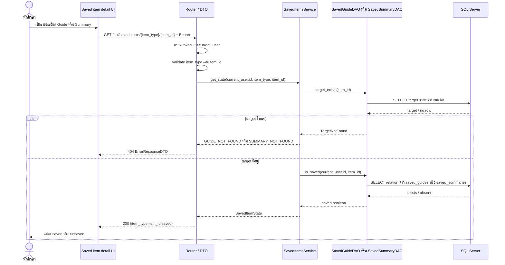
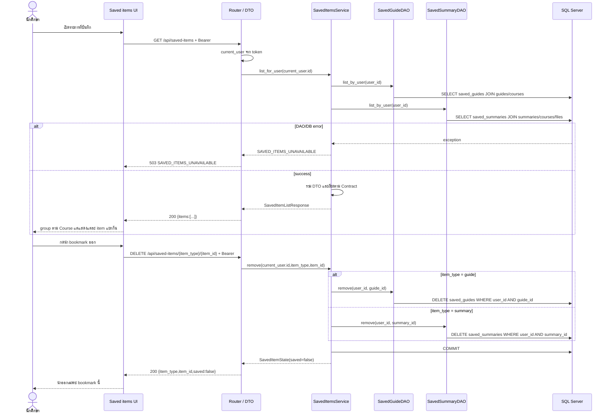

# Task103 U9 — Sequence Diagrams

**รุ่น 0.2 | 15 พฤศจิกายน 2569 | Draft for Review**

Sequence ที่ปรับตาม Task94 v0.4 และ Task104 U10 v0.3 โดยใช้ relation ร่วมกัน (`saved_guides`, `saved_summaries`) และ transaction เริ่มก่อน target SELECT

## 1. อ่านสถานะ



## 2. บันทึกผลงาน

```mermaid
sequenceDiagram
    actor Student as นักศึกษา
    participant UI as Saved item detail UI
    participant API as Router / DTO
    participant SVC as SavedItemsService
    participant DAO as SavedGuideDAO หรือ SavedSummaryDAO
    participant DB as SQL Server
    Student->>UI: กดบันทึกผลงาน
    UI->>API: PUT /api/saved-items/{item_type}/{item_id} + Bearer
    API->>API: ตรวจ token, current_user, type และ ID
    API->>SVC: save(current_user.id, item_type, item_id)
    Note over SVC,DB: BEGIN ต้องเกิดก่อน SELECT เพื่อป้องกัน SQLAlchemy autobegin
    SVC->>DB: session.begin()
    SVC->>DAO: target_exists(session, item_id)
    DAO->>DB: SELECT target ตามชนิด
    DB-->>DAO: target record
    alt target ไม่มี
        DAO-->>SVC: TargetNotFound
        SVC->>DB: ROLLBACK
        SVC-->>API: GUIDE_NOT_FOUND หรือ SUMMARY_NOT_FOUND
        API-->>UI: 404 ErrorResponseDTO
    else target มี
        SVC->>DAO: insert_if_absent(session, current_user.id, item_id)
        DAO->>DB: INSERT relation โดย unique PK กันซ้ำ
        DB-->>DAO: inserted หรือ duplicate key ของ relation เดิม
        DAO-->>SVC: idempotent save result
        SVC->>DB: COMMIT
        DB-->>SVC: commit confirmed
        SVC-->>API: SavedItemState(saved=true)
        API-->>UI: 200 {item_type,item_id,saved:true}
        UI-->>Student: แสดงบันทึกแล้ว; duplicate message ใช้ state ที่ UI รู้ก่อน PUT
    end
    Note over API,UI: DB read/write/commit failure = 503 SAVED_ITEMS_UNAVAILABLE
```

## 3. ดูรายการและนำออก (U10 shared relation)



ข้อผิดพลาด DB read/write/commit ของ saved-items ให้ตอบ `503 SAVED_ITEMS_UNAVAILABLE`; target missing ตอบ 404 ตามชนิด; validation 422; auth 401.
