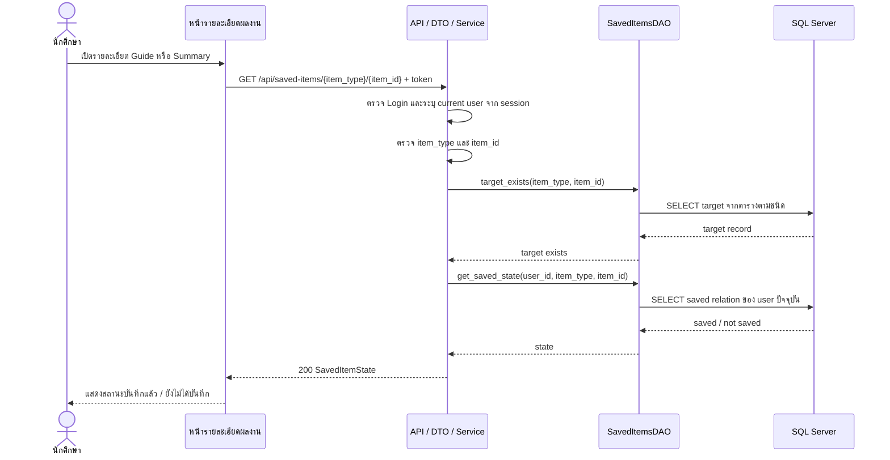

# Task103 U9 Sequence Diagram

รุ่น 0.1 | วันที่ 13 พฤศจิกายน 2569 | แบบเสนอสำหรับ review ยังไม่ใช่ flow ที่ implement แล้ว

แต่ละภาพแสดงเส้นทางสำเร็จเป็นหลัก รวม Router, DTO และ Service เป็นช่อง API เดียวเพื่อให้อ่านลำดับได้ง่าย DAO และ SQL Server แยกหน้าที่ชัดเจน กรณีผิดพลาดอยู่ในตารางใต้ภาพ เมื่อพบข้อผิดพลาดให้หยุดเส้นทางสำเร็จ ณ ขั้นที่เกี่ยวข้อง

อ่านคู่กับ [แบบ DAO](task103-u9-dao-design.md) และ [แผนทดสอบกับ review](task103-u9-review-and-test-plan.md) ไฟล์ `.mmd` เป็นต้นฉบับแก้ไขได้

## 1 อ่านสถานะการบันทึก

[ต้นฉบับ Mermaid](diagrams/task103-saved-state.mmd)



| กรณี | ผลลัพธ์ |
| --- | --- |
| ไม่มี token, token ผิดหรือหมดอายุ | 401 `AUTH_REQUIRED` พร้อม `WWW-Authenticate: Bearer` |
| item_type หรือ item_id ผิดรูปแบบ | 422 `INVALID_PARAMETERS` |
| target ไม่พบตามชนิดที่ระบุ | 404 ตาม error code ที่ Contract อนุมัติ |
| ส่ง user_id/owner_id ที่ไม่อนุญาต | 422 `INVALID_PARAMETERS` |
| DB อ่านไม่ได้ | 503 ตาม Contract; ห้ามแสดงเป็น `saved:false` |
| target มีอยู่แต่ยังไม่ saved | 200 `saved:false` |

## 2 บันทึกผลงานที่สนใจ

[ต้นฉบับ Mermaid](diagrams/task103-save-item.mmd)

```mermaid
sequenceDiagram
    actor Student as นักศึกษา
    participant UI as หน้ารายละเอียดผลงาน
    participant API as API / DTO / Service
    participant DAO as SavedItemsDAO
    participant SQL as SQL Server
    Student->>UI: กดบันทึก Guide หรือ Summary
    UI->>API: PUT /api/saved-items/{item_type}/{item_id} + token
    API->>API: ตรวจ Login และระบุ current user จาก session
    API->>API: ตรวจ item_type และ item_id
    API->>DAO: target_exists(item_type, item_id)
    DAO->>SQL: SELECT target จากตารางตามชนิด
    SQL-->>DAO: target record
    DAO-->>API: target exists
    API->>SQL: BEGIN TRANSACTION
    API->>DAO: insert_saved_if_absent(user_id, item_type, item_id)
    DAO->>SQL: INSERT relation; unique constraint ป้องกันรายการซ้ำ
    SQL-->>DAO: inserted หรือ already exists
    DAO-->>API: save result
    API->>SQL: COMMIT
    SQL-->>API: ยืนยันผล commit
    API-->>UI: 200 save result / duplicate result ตาม Contract
    UI-->>Student: แจ้งบันทึกสำเร็จ หรือ “ได้บันทึกการแบ่งปันนี้ไปแล้ว”
```

| กรณี | ผลลัพธ์ |
| --- | --- |
| ไม่มี token, token ผิดหรือหมดอายุ | 401 `AUTH_REQUIRED` พร้อม `WWW-Authenticate: Bearer` |
| item_type/item_id ผิดรูปแบบ | 422 `INVALID_PARAMETERS` |
| ส่ง user_id/owner_id หรือ field เจ้าของที่ไม่อนุญาต | 422 `INVALID_PARAMETERS` |
| target ไม่พบ | 404 ตามชนิด; ไม่สร้าง target ใหม่ |
| บันทึกซ้ำ | คง saved relation เพียงหนึ่งรายการ และแจ้ง “ได้บันทึกการแบ่งปันนี้ไปแล้ว” |
| คำขอพร้อมกัน | unique constraint ต้องทำให้เหลือหนึ่ง relation |
| DB ล้มเหลวก่อน commit และยืนยัน rollback | error ตาม Contract; UI ไม่แสดง success |
| ผล commit ไม่แน่ชัด/response timeout | UI อ่านสถานะใหม่ก่อน retry; ห้ามเดาว่าบันทึกไม่สำเร็จ |

## 3 ข้อกำหนดที่ต้องยืนยันก่อนใช้ Sequence เป็น Contract

- Path `/api/saved-items/{item_type}/{item_id}` เป็นข้อเสนอ ไม่ใช่ endpoint ที่อนุมัติแล้ว
- Status code และ DTO ของ duplicate ต้องตกลงร่วมกัน; PO ยืนยันข้อความ UI แต่ Task98 ไม่ได้ระบุ status/body
- ชื่อตาราง/คอลัมน์และกลไก unique ต้องตรงแบบ Task100
- ไม่รวมการ migrate `saved_guides` เดิม
- การบันทึกผลงานของตนเองได้หรือไม่ยังรอ PO
