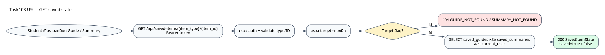
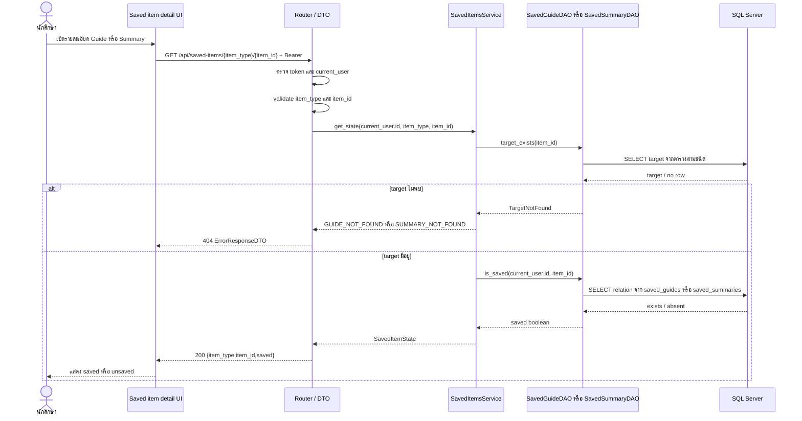
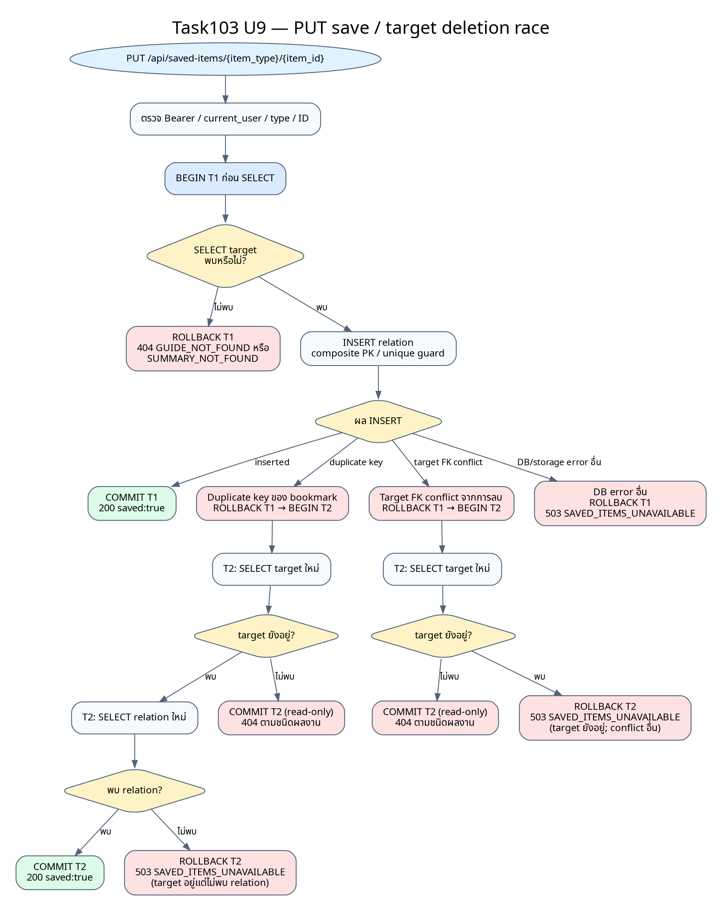
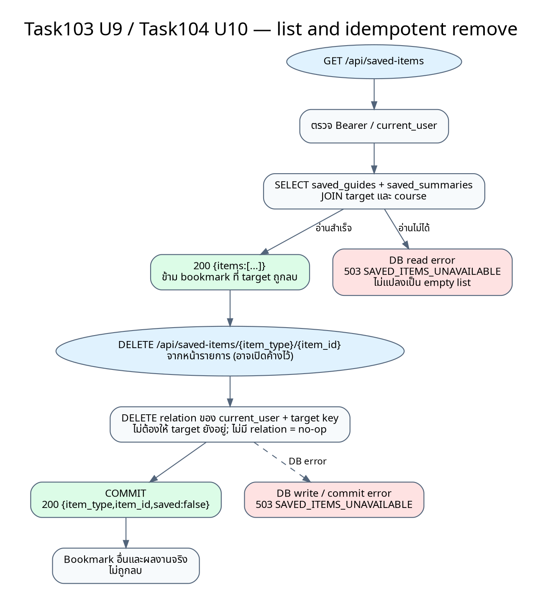

# Task103 U9 — Sequence Diagrams

**รุ่น 0.4 | 15 พฤศจิกายน 2569 | Draft for Review**

Sequence ที่ปรับตาม Task94 v0.4 และ Task104 U10 v0.3 โดยใช้ relation ร่วมกัน (`saved_guides`, `saved_summaries`) และ transaction เริ่มก่อน target SELECT; duplicate-key แยกเป็น rollback แล้วอ่าน state ใหม่

## 1. อ่านสถานะ





## 2. บันทึกผลงาน

ภาพนี้แยกผล `INSERT` สำเร็จออกจาก `duplicate key` อย่างชัดเจน: กรณี INSERT สำเร็จจึง COMMIT transaction เดิม ส่วน duplicate-key ที่ยืนยันว่าเป็น unique conflict ของ bookmark key ที่ต้องการ จะ ROLLBACK transaction ที่ล้มเหลวก่อน แล้วเริ่ม transaction ใหม่เพื่ออ่านสถานะ หากพบ relation จึงตอบ success DTO เดียวกัน



```mermaid
sequenceDiagram
    actor Student as นักศึกษา
    participant UI as Saved item detail UI
    participant API as Router / DTO
    participant SVC as SavedItemsService
    participant DAO as SavedGuideDAO หรือ SavedSummaryDAO
    participant DB as SQL Server
    Student->>UI: กดบันทึกผลงาน
    UI->>API: PUT /api/saved-items/{item_type}/{item_id} + Bearer
    API->>API: ตรวจ token, current_user, type และ ID
    API->>SVC: save(current_user.id, item_type, item_id)
    Note over SVC,DB: BEGIN ก่อน SELECT เพื่อป้องกัน SQLAlchemy autobegin
    SVC->>DB: BEGIN transaction T1
    SVC->>DAO: target_exists(session, item_id)
    DAO->>DB: SELECT target ตามชนิด
    DB-->>DAO: target record
    alt target ไม่มี
        DAO-->>SVC: TargetNotFound
        SVC->>DB: ROLLBACK T1
        SVC-->>API: GUIDE_NOT_FOUND หรือ SUMMARY_NOT_FOUND
        API-->>UI: 404 ErrorResponseDTO
    else target มี
        SVC->>DAO: insert_if_absent(session, current_user.id, item_id)
        DAO->>DB: INSERT relation โดย composite PK กันซ้ำ
        alt INSERT สำเร็จ
            DB-->>DAO: inserted
            DAO-->>SVC: inserted
            SVC->>DB: COMMIT T1
            DB-->>SVC: commit confirmed
            SVC-->>API: SavedItemState(saved=true)
            API-->>UI: 200 {item_type,item_id,saved:true}
        else duplicate key ของ bookmark key เดิม
            DB-->>DAO: unique constraint violation
            DAO-->>SVC: DuplicateKey เฉพาะ constraint ที่คาดหมาย
            SVC->>DB: ROLLBACK T1
            Note over SVC,DB: ห้าม query ต่อใน transaction ที่ failed
            SVC->>DB: BEGIN transaction T2 (หลัง rollback)
            SVC->>DAO: target_exists(item_id) ใน T2
            DAO->>DB: SELECT target ตามชนิดใหม่
            DB-->>DAO: target exists / missing
            alt target หาย
                SVC->>DB: COMMIT T2 (read-only)
                SVC-->>API: GUIDE_NOT_FOUND หรือ SUMMARY_NOT_FOUND
                API-->>UI: 404 ErrorResponseDTO
            else target ยังอยู่
                SVC->>DAO: is_saved(current_user.id, item_id)
                DAO->>DB: SELECT relation จาก saved_guides หรือ saved_summaries
                DB-->>DAO: relation exists / absent
                DAO-->>SVC: saved state
                alt relation พบ
                    SVC->>DB: COMMIT T2
                    SVC-->>API: SavedItemState(saved=true)
                    API-->>UI: 200 {item_type,item_id,saved:true}
                else relation ไม่พบ
                    SVC->>DB: ROLLBACK T2
                    SVC-->>API: SAVED_ITEMS_UNAVAILABLE
                    API-->>UI: 503 SAVED_ITEMS_UNAVAILABLE
                end
            end
        else target FK conflict จากการลบระหว่าง INSERT
            Note over DAO,DB: แยกจาก duplicate-key; ตรวจเฉพาะ target FK constraint ที่กำหนดไว้
            DB-->>DAO: expected target FK violation
            DAO-->>SVC: TargetWriteConflict
            SVC->>DB: ROLLBACK T1
            SVC->>DB: BEGIN transaction T2
            SVC->>DAO: target_exists(item_id)
            DAO->>DB: SELECT target ตามชนิดใหม่
            DB-->>DAO: target missing / exists
            alt target หายแล้ว
                SVC->>DB: COMMIT T2 (read-only)
                SVC-->>API: GUIDE_NOT_FOUND หรือ SUMMARY_NOT_FOUND
                API-->>UI: 404 ErrorResponseDTO
            else target ยังอยู่
                SVC->>DB: ROLLBACK T2
                SVC-->>API: SAVED_ITEMS_UNAVAILABLE
                API-->>UI: 503 SAVED_ITEMS_UNAVAILABLE
            end
        else DB error อื่นที่ไม่ใช่ duplicate key หรือ target FK conflict ที่คาดหมาย
            DB-->>DAO: SQL/storage exception
            DAO-->>SVC: propagate exception
            SVC->>DB: ROLLBACK T1
            SVC-->>API: SAVED_ITEMS_UNAVAILABLE
            API-->>UI: 503 SAVED_ITEMS_UNAVAILABLE
        end
    end
    Note over API,UI: ทั้ง first save และ duplicate success ใช้ 200 และ SavedItemState เดียวกัน
    Note over UI: ข้อความ “ได้บันทึกการแบ่งปันนี้ไปแล้ว” ใช้ saved state ที่ UI รู้ก่อน PUT ไม่ได้มาจาก response field เพิ่มเติม
```

## 3. ดูรายการและนำออก (U10 shared relation)



```mermaid
sequenceDiagram
    actor Student as นักศึกษา
    participant UI as Saved items UI
    participant API as Router / DTO
    participant SVC as SavedItemsService
    participant GDAO as SavedGuideDAO
    participant SDAO as SavedSummaryDAO
    participant DB as SQL Server
    Student->>UI: เปิดรายการที่บันทึก
    UI->>API: GET /api/saved-items + Bearer
    API->>API: current_user จาก token
    API->>SVC: list_for_user(current_user.id)
    SVC->>GDAO: list_by_user(user_id)
    GDAO->>DB: SELECT saved_guides JOIN guides/courses
    SVC->>SDAO: list_by_user(user_id)
    SDAO->>DB: SELECT saved_summaries JOIN summaries/courses/files
    alt DAO/DB error
        DB-->>SVC: exception
        SVC-->>API: SAVED_ITEMS_UNAVAILABLE
        API-->>UI: 503 SAVED_ITEMS_UNAVAILABLE
    else success
        SVC->>SVC: รวมเฉพาะ bookmark ที่ JOIN พบ target; ข้าม target ที่ถูกลบ
        SVC->>SVC: เรียง DTO ตาม Contract
        SVC-->>API: SavedItemListResponse
        API-->>UI: 200 {items:[...]}
        UI-->>Student: group ตาม Course แต่แสดงแต่ละ item แยกกัน
    end
    Student->>UI: กดนำ bookmark ออกจากหน้ารายการ (อาจเปิดค้างไว้ก่อน target ถูกลบ)
    UI->>API: DELETE /api/saved-items/{item_type}/{item_id} + Bearer
    API->>SVC: remove(current_user.id,item_type,item_id)
    alt item_type = guide
        SVC->>GDAO: remove(user_id, guide_id)
        GDAO->>DB: DELETE saved_guides WHERE user_id AND guide_id
    else item_type = summary
        SVC->>SDAO: remove(user_id, summary_id)
        SDAO->>DB: DELETE saved_summaries WHERE user_id AND summary_id
    end
    Note over SVC,DB: DELETE relation ทำได้แม้ target ถูกลบไปแล้ว; ไม่มี relation ก็ถือเป็น no-op
    SVC->>DB: COMMIT
    SVC-->>API: SavedItemState(saved=false)
    API-->>UI: 200 {item_type,item_id,saved:false}
    UI-->>Student: นำออกเฉพาะ bookmark นี้; กดซ้ำได้ผลเดิม
```

### ผลเมื่อ target ถูกลบ แยกตาม endpoint (Task94 v0.4 ข้อ 7)

| Endpoint | เมื่อผลงานไม่อยู่แล้ว | พฤติกรรม |
|---|---|---|
| `GET /api/saved-items/{item_type}/{item_id}` | `404 GUIDE_NOT_FOUND` หรือ `404 SUMMARY_NOT_FOUND` | แยกตามชนิดผลงาน |
| `PUT /api/saved-items/{item_type}/{item_id}` | `404 GUIDE_NOT_FOUND` หรือ `404 SUMMARY_NOT_FOUND` | รวมกรณี target หายก่อนเริ่มเขียนหรือยืนยันว่าหายหลัง rollback/recheck |
| `DELETE /api/saved-items/{item_type}/{item_id}` | `200 {item_type,item_id,saved:false}` | ลบ relation ถ้ายังมี; ถ้าไม่มีหรือ target ถูกลบแล้วเป็น no-op idempotent |
| `GET /api/saved-items` | `200` และข้าม bookmark ที่อ้างถึง target ที่ถูกลบ | หาก DB อ่านไม่ได้จริงให้ `503 SAVED_ITEMS_UNAVAILABLE` ไม่ตีความเป็นรายการว่าง |

สำหรับ PUT ที่ target ถูกลบระหว่าง SELECT กับ INSERT ให้จัดการเฉพาะ target FK conflict ที่ระบุ constraint ได้: ROLLBACK T1 แล้ว BEGIN T2 เพื่อตรวจ target ใหม่ หากไม่พบให้ตอบ 404 ตามชนิด; หาก target ยังอยู่แต่ไม่พบ relation ที่ยืนยัน idempotent success ได้ ให้ตอบ `503 SAVED_ITEMS_UNAVAILABLE`. ใน duplicate-key recovery ให้ตรวจ target และ relation ใหม่หลัง rollback เช่นกัน: พบ target และ relation จึงตอบ `200 saved:true`; target หายตอบ 404; อ่านไม่ได้หรือ target ยังอยู่แต่ relation ไม่พบให้ตอบ 503. ห้ามส่ง conflict response ที่ไม่ได้กำหนดไว้ใน Task94.

ข้อผิดพลาด DB read/write/commit ของ saved-items ให้ตอบ `503 SAVED_ITEMS_UNAVAILABLE`; validation 422; auth 401.
