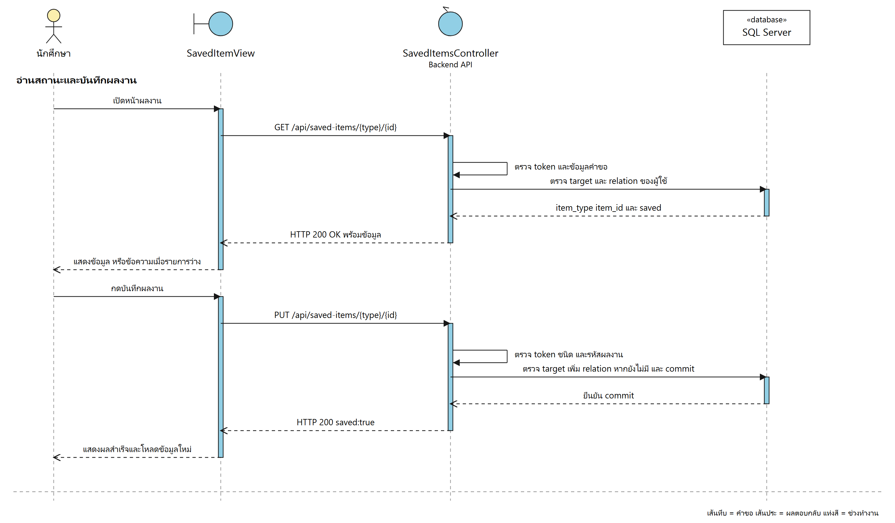
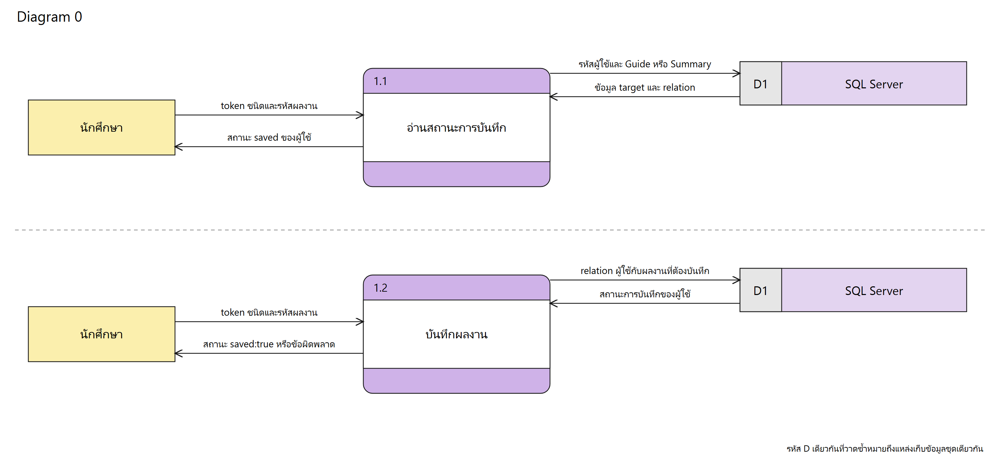

# U9 บันทึกแนวข้อสอบหรือสรุป PDF

แผนภาพสำหรับอธิบายการทำงานของระบบ ใช้สีและสัญลักษณ์ตามชุด U6

## ระบบนี้ช่วยอะไร

บันทึกแนวข้อสอบหรือสรุป PDF ผ่านหน้าเว็บที่เชื่อมกับ Backend และข้อมูลของระบบ

## UML Sequence Diagram

อ่านจากบนลงล่าง เส้นทึบคือคำขอ เส้นประคือผลตอบกลับ แท่งสีแสดงช่วงทำงาน ชื่อ View รวมหน้าเว็บและ JavaScript ส่วน Controller รวม Router, Service และ DAO; คำขอผ่าน Node proxy แต่ไม่แยกเป็น lifeline ภาพเน้นเส้นทางสำเร็จ รายละเอียด error อยู่ในเอกสารออกแบบเดิม

type คือ guide หรือ summary ไม่ใช่การ bookmark รายวิชาทั้งวิชา รายวิชาใช้จัดกลุ่มเท่านั้น กดซ้ำไม่สร้าง relation ซ้ำ; เมื่อเกิด duplicate key ที่คาดหมาย ต้อง rollback transaction ที่ล้มเหลวก่อนอ่านสถานะใหม่ และตอบ saved:true เมื่อยืนยัน relation แล้ว ผู้ใช้แต่ละคนมี relation แยกกัน

## Dataflow Diagram

กล่องสีเหลืองคือนักศึกษาหรือระบบภายนอก กล่อง process สีม่วงแสดงงาน ลูกศรระบุข้อมูลที่ส่งระหว่างกัน รหัส D เดียวกันที่วาดซ้ำหมายถึงแหล่งข้อมูลชุดเดียวกัน การตรวจ token อยู่ที่ขอบเขต Backend ตาม U1 ไม่ได้วาดซ้ำทุก process

**1.1 อ่านสถานะการบันทึก** รับ token ชนิดและรหัสผลงาน แล้วส่งกลับ สถานะ saved ของผู้ใช้ โดยอ่านหรือเปลี่ยนข้อมูลตามลูกศรในภาพ

**1.2 บันทึกผลงาน** รับ token ชนิดและรหัสผลงาน แล้วส่งกลับ สถานะ saved:true หรือข้อผิดพลาด โดยอ่านหรือเปลี่ยนข้อมูลตามลูกศรในภาพ

## ไฟล์อ้างอิง

- [saved_items.py](../../../backend/app/routers/saved_items.py)
- [saved_items.py](../../../backend/app/services/saved_items.py)
- [task103-u9-sequences.md](task103-u9-sequences.md)
- [SVG Sequence ที่แก้ไขได้](diagrams/u9-sequence.svg)
- [SVG Dataflow ที่แก้ไขได้](diagrams/u9-dataflow.svg)
